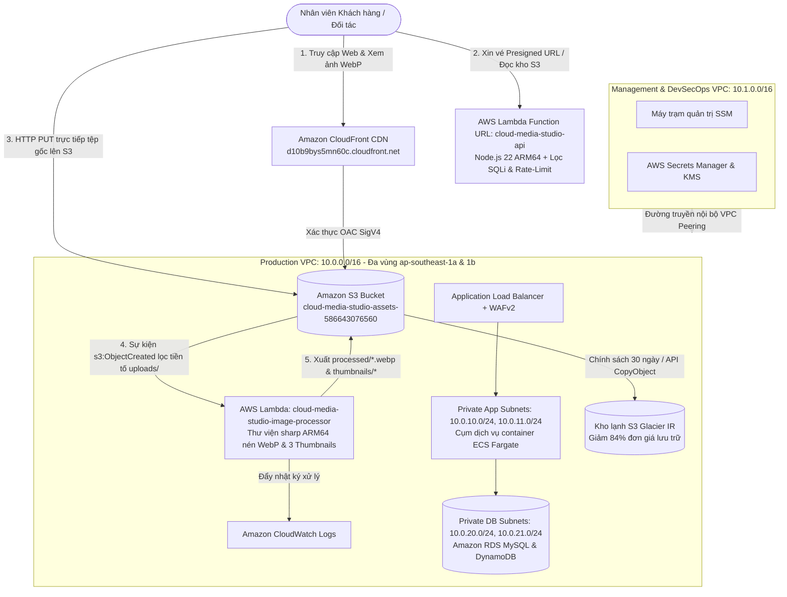

# HỒ SƠ TƯ VẤN, THIẾT KẾ, TRIỂN KHAI VÀ BÀN GIAO HỆ THỐNG ĐÁM MÂY
## BÁO CÁO BÀI TẬP LỚN CUỐI KỲ — HỌC PHẦN: ĐIỆN TOÁN ĐÁM MÂY

**TÊN DỰ ÁN:** TƯ VẤN VÀ TRIỂN KHAI NỀN TẢNG QUẢN TRỊ, CHUYỂN ĐỔI & PHÂN PHỐI ĐA PHƯƠNG TIỆN (CLOUD MEDIA STUDIO) TRÊN HẠ TẦNG AWS PUBLIC CLOUD

- **Đơn vị tư vấn & triển khai (Nhóm thực hiện):** Nhóm Kỹ sư Giải pháp Đám mây **NovaCloud Consulting**
- **Khách hàng doanh nghiệp ( Giả định thực tế ):** Công ty Truyền thông & Sản xuất Nội dung số **Lumina Creative Agency**
- **Hạ tầng triển khai thực tế:** Amazon Web Services (AWS) tại vùng `ap-southeast-1` (Singapore)
- **Mã tài khoản AWS vận hành:** `586643076560`
- **Tên miền phân phối sản phẩm (CDN):** `https://d10b9bys5mn60c.cloudfront.net`
- **Cổng dịch vụ Serverless API:** `https://jtkvl7zyutkt34p3m5g3ui76ge0mehbp.lambda-url.ap-southeast-1.on.aws`
- **Kho mã nguồn & Quy trình tự động bàn giao:** GitHub Repository (`cloud-media-studio`)

### Bảng phân công nhân sự đội ngũ tư vấn & triển khai

| STT | Chức danh trong dự án | Định danh IAM trên AWS | Trách nhiệm xuyên suốt từ Khảo sát đến Bàn giao |
| :---: | :--- | :--- | :--- |
| 1 | **Trưởng nhóm Giải pháp & Hạ tầng Mạng** (Member 1) | `member1-network-iac` | Khảo sát yêu cầu mạng khách hàng, thiết kế kiến trúc Dual-VPC Multi-AZ, định tuyến CloudFront CDN và đóng gói mã hạ tầng Terraform để bàn giao. |
| 2 | **Kỹ sư Ứng dụng & Tính toán Đám mây** (Member 2) | `member2-compute-container` | Phát triển cổng giao diện Cloud Media Studio, xây dựng luồng S3 Presigned URL, đóng gói container ECS/ECR và lập trình hàm AWS Lambda nén ảnh `sharp` trên chip ARM64. |
| 3 | **Chuyên viên Dữ liệu & Tối ưu Chi phí FinOps** (Member 3) | `member3-data-finops` | Tư vấn bài toán chi phí cho khách hàng, thiết kế cơ sở dữ liệu RDS/DynamoDB, cấu hình vòng đời lưu trữ lạnh S3 Glacier và thiết lập trần ngân sách AWS Budgets. |
| 4 | **Kỹ sư An toàn Thông tin & DevSecOps** (Member 4) | `member4-security-devsecops` | Thiết kế ma trận phân quyền IAM tối thiểu, dựng đường ống CI/CD xác thực OIDC không khóa tĩnh, quét lỗ hổng Trivy, cấu hình tường lửa WAFv2 và chạy kiểm thử nghiệm thu bảo mật. |

---

## MỤC LỤC HỒ SƠ DỰ ÁN
1. **PHẦN 1. ĐẶT VẤN ĐỀ: HIỆN TRẠNG VÀ YÊU CẦU BAN ĐẦU TỪ KHÁCH HÀNG**
2. **PHẦN 2. PHÂN TÍCH, THẢO LUẬN VÀ CHỐT KẾ HOẠCH GIẢI PHÁP VỚI KHÁCH HÀNG**
3. **PHẦN 3. THIẾT KẾ CHI TIẾT KIẾN TRÚC HỆ THỐNG TRÊN AWS**
4. **PHẦN 4. QUÁ TRÌNH TRIỂN KHAI CÀI ĐẶT, CẤU HÌNH VÀ GỠ LỖI THỰC TẾ**
5. **PHẦN 5. KẾT QUẢ KIỂM THỬ NGHIỆM THU HỆ THỐNG (UAT)**
6. **PHẦN 6. BÀN GIAO HỆ THỐNG, CHUYỂN GIAO CÔNG NGHỆ VÀ ĐỊNH HƯỚNG MỞ RỘNG**

---

## PHẦN 1. ĐẶT VẤN ĐỀ: HIỆN TRẠNG VÀ YÊU CẦU BAN ĐẦU TỪ KHÁCH HÀNG

### 1.1. Bối cảnh hoạt động và hiện trạng hạ tầng của khách hàng
Khách hàng của dự án là **Lumina Creative Agency**, một đơn vị chuyên chụp ảnh sản phẩm độ phân giải cao (4K), thiết kế ấn phẩm quảng cáo và dựng các đoạn video ngắn phục vụ hơn 30 nhãn hàng bán lẻ trực tuyến tại Việt Nam và khu vực Đông Nam Á.

Trước khi tìm đến đội ngũ tư vấn, toàn bộ quy trình lưu trữ và chia sẻ tệp tin của khách hàng đang đặt trên một máy chủ vật lý tự quản lý (On-Premise) đặt tại văn phòng Hà Nội. Qua buổi khảo sát hiện trạng ban đầu, phía khách hàng chia sẻ ba khó khăn lớn đang làm gián đoạn công việc kinh doanh hàng tuần:

1. **Tốc độ tải ảnh trên trang đối tác quá chậm do dùng nguyên ảnh gốc:** Đội nhiếp ảnh thường xuất tệp PNG hoặc JPG gốc nặng từ 4 MB đến hơn 20 MB rồi gửi thẳng đường dẫn cho khách hàng nhúng lên website bán hàng. Người mua hàng mở bằng điện thoại qua mạng 4G phải đợi rất lâu ảnh mới hiện ra hết, trong khi đường truyền mạng tại văn phòng công ty liên tục bị nghẽn băng thông. Việc bắt nhân viên thiết kế ngồi cắt tay từng bức ảnh ra 3–4 cỡ nhỏ trước khi tải lên lại tốn quá nhiều giờ công thủ công.
2. **Máy chủ vật lý thường xuyên treo vào đợt cao điểm nhưng lại bỏ không vào ban đêm:** Vào các dịp cận chiến dịch khuyến mãi, khi 15–20 nhân viên cùng tải ảnh dung lượng lớn lên máy chủ để nén và xuất bản xem trước, CPU máy chủ chạm mức 100% dẫn tới treo toàn bộ trang quản lý. Ngược lại, từ sau 19 giờ tối đến sáng hôm sau và các ngày cuối tuần, máy chủ gần như không có người dùng nhưng vẫn tiêu tốn điện năng và chi phí bảo trì cố định.
3. **Ổ cứng lưu trữ phình to vì dữ liệu chiến dịch cũ:** Đặc thù ngành quảng cáo là các bộ ảnh chỉ được truy cập dày đặc trong khoảng 3 đến 4 tuần diễn ra chiến dịch. Sau thời gian đó, khách hàng yêu cầu giữ lại tệp gốc từ 1 đến 3 năm để đối chiếu hợp đồng khi cần, rất hiếm khi mở lại. Việc dồn toàn bộ ảnh cũ nhiều năm nằm chung trên ổ cứng SSD tốc độ cao khiến công ty liên tục phải mua thêm ổ cứng mới rất tốn kém.

### 1.2. Mong muốn ban đầu từ phía khách hàng
Khi mới tiếp xúc, đại diện khách hàng đưa ra đề bài sơ bộ khá đơn giản theo thói quen cũ: *"Công ty muốn thuê một máy chủ ảo cấu hình thật mạnh trên AWS bật 24/7 để cài lại phần mềm web cũ, mở một kho lưu trữ công khai cho nhân viên quăng ảnh lên cho nhanh, miễn sao chi phí triển khai thử nghiệm và vận hành giai đoạn đầu nằm gọn trong gói ngân sách 200 USD."*

---

## PHẦN 2. PHÂN TÍCH, THẢO LUẬN VÀ CHỐT KẾ HOẠCH GIẢI PHÁP VỚI KHÁCH HÀNG

### 2.1. Phân tích kỹ thuật và tư vấn điều chỉnh yêu cầu cùng khách hàng
Từ yêu cầu thô ban đầu của khách hàng, nhóm tư vấn đã tổ chức phiên thảo luận phân tích lợi hại để thuyết phục khách hàng điều chỉnh phương án trước khi bắt tay vào thiết kế:

- **Bác bỏ phương án thuê máy chủ lớn bật 24/7 để nén ảnh:** Nhóm tư vấn lập bảng tính chi phí cho khách hàng thấy nếu thuê máy chủ EC2 cấu hình cao kèm bộ cân bằng tải ALB và cổng NAT Gateway chạy xuyên suốt 24/7, riêng tiền thuê máy rảnh rỗi và phí duy trì cổng mạng đã tiêu tốn khoảng 70 – 90 USD mỗi tháng, làm cạn nhanh ngân sách 200 USD ngay cả khi đêm không có ai tải ảnh. Nhóm đề xuất chuyển khâu nén ảnh sang mô hình **Serverless hướng sự kiện (AWS Lambda chạy chip ARM64)**: chỉ khi nào có ảnh mới rơi vào kho chứa thì hàm xử lý mới thức dậy chạy trong khoảng 2 giây rồi tắt, tháng đầu tiên với hàng trăm nghìn lượt gọi chi phí tính toán bằng **0 USD**.
- **Thay thế phương án "mở kho chứa công khai" bằng cơ chế chữ ký số tạm thời:** Nhóm cảnh báo rõ với khách hàng rằng nếu mở quyền đọc/ghi công khai (Public Bucket) trên Amazon S3, người ngoài có thể dò quét lấy cắp ấn phẩm chưa công bố của nhãn hàng hoặc tải tệp rác làm bùng nổ hóa đơn lưu trữ. Phương án thay thế được khách hàng đồng thuận là khóa kín hoàn toàn S3 Bucket: chiều đọc đi qua mạng biên **Amazon CloudFront gắn chứng thực OAC**, còn chiều tải lên đi qua vé ủy quyền tạm thời **S3 Presigned PUT URL** có thời hạn đúng 5 phút.
- **Tư vấn tách lớp lưu trữ nóng - lạnh tự động:** Thay vì để ảnh cũ chiếm chỗ lưu trữ đắt tiền, nhóm đề xuất áp dụng chính sách vòng đời tự động chuyển các tệp quá 30 ngày từ lớp chuẩn `S3 Standard` (`0,025 USD/GB/tháng`) xuống lớp kho lạnh truy xuất tức thì `S3 Glacier Instant Retrieval` (`0,004 USD/GB/tháng`), giúp khách hàng cắt giảm ngay **84% chi phí lưu trữ dài hạn**.

### 2.2. Bảng đối chiếu Kế hoạch thống nhất (Yêu cầu chi tiết <-> Giải pháp đề xuất)

Sau quá trình trao đổi, hai bên thống nhất ký duyệt bản kế hoạch triển khai nền tảng **Cloud Media Studio** với ma trận ánh xạ trực tiếp từ từng yêu cầu nghiệp vụ sang giải pháp công nghệ trên AWS (kết hợp cả nhóm dịch vụ cốt lõi và nhóm dịch vụ mở rộng chuyên sâu):

| Mã YC | Yêu cầu chi tiết đã chốt với Khách hàng | Giải pháp kỹ thuật đề xuất từ Đội ngũ tư vấn | Dịch vụ AWS nền tảng (Cơ bản) | Dịch vụ hỗ trợ & Công nghệ mở rộng (Nâng cao) |
| :---: | :--- | :--- | :--- | :--- |
| **YC-01** | Tải ảnh 4K/video từ trình duyệt ở bất kỳ đâu lên kho lưu trữ mà không lộ khóa tài khoản AWS, không nghẽn cổ chai máy chủ. | Cổng Serverless API cấp phát đường dẫn ký số tạm thời (5 phút) để trình duyệt đẩy thẳng luồng nhị phân vào S3 qua kết nối HTTPS. | Amazon S3, AWS IAM | **AWS Lambda Function URL**, **S3 Presigned PUT URL (SigV4)**, **S3 CORS** |
| **YC-02** | Tự động nén ảnh giảm trên 70% dung lượng và cắt sẵn 3 cỡ ảnh nhỏ ngay khi nhân viên vừa tải tệp lên. | Bắt sự kiện tệp mới trong thư mục `uploads/` để gọi hàm xử lý ảnh nhị phân `sharp` xuất ra chuẩn `.webp` và 3 bản Thumbnail (`320w`, `768w`, `1200w`). | IAM Role, CloudWatch | **S3 Event Notifications**, **AWS Lambda (Chip ARM64 Graviton2)**, thư viện **Sharp Libvips** |
| **YC-03** | Website đối tác tại Việt Nam & Đông Nam Á mở ảnh nhanh dưới 50 ms, đồng thời khóa chặt kho S3 gốc. | Phân phối toàn bộ giao diện và ảnh đã nén qua trạm biên CDN gần người xem nhất; khóa S3 chỉ nhận yêu cầu có chữ ký từ CDN. | Amazon S3 Bucket Policy | **Amazon CloudFront CDN** (`PriceClass_100`), **Origin Access Control (OAC)** |
| **YC-04** | Hạ tầng mạng doanh nghiệp tách biệt vùng ứng dụng, cơ sở dữ liệu và vùng quản trị nội bộ, sẵn sàng mở rộng chịu tải lớn. | Dựng mô hình 2 mạng VPC nối nhau qua Peering; chia 6 Subnets trên 2 vùng sẵn sàng tại Singapore; đóng gói sẵn cụm container API. | VPC, 6 Subnets, IGW, NAT GW, Security Groups, RDS MySQL | **Dual-VPC Peering**, **Amazon ECS Fargate**, **Amazon ECR**, **Application Load Balancer** |
| **YC-05** | Chống tấn công chèn mã độc vào ô tìm kiếm tài nguyên, chống spam yêu cầu làm treo dịch vụ. | Kiểm tra mẫu tấn công SQLi/XSS trả về mã chặn `403` và bộ đếm giới hạn tốc độ yêu cầu theo IP trả về mã `429`. | Security Groups, Parameterized Queries | **AWS WAFv2** (`SQLiRuleSet`), **Rate-Limiting Middleware**, kiểm thử tải **Grafana k6** |
| **YC-06** | Dữ liệu cũ quá 30 ngày phải tự giảm chi phí lưu trữ; tổng hóa đơn thử nghiệm tuyệt đối không vượt trần 200 USD. | Tự động chuyển lớp lưu trữ lạnh sau 30 ngày; gắn công tắc mã hóa bật/tắt các thiết bị mạng tính phí theo giờ; cài cảnh báo email sớm. | S3 Storage Classes | **S3 Glacier Instant Retrieval**, **AWS Budgets**, **Terraform Feature Flags** |
| **YC-07** | Đội IT nội bộ của khách hàng dễ dàng cập nhật giao diện/code về sau mà không cần thao tác tay phức tạp hay giữ khóa bảo mật. | Bàn giao đường ống tự động hóa kiểm tra code, quét lỗ hổng bảo mật container, mượn quyền tạm thời đẩy lên S3 và làm mới CDN. | Git, AWS CLI | **Terraform IaC**, **GitHub Actions CI/CD**, **AWS OIDC Federation**, **Aqua Security Trivy** |

---

## PHẦN 3. THIẾT KẾ CHI TIẾT KIẾN TRÚC HỆ THỐNG TRÊN AWS

Sau khi khách hàng phê duyệt kế hoạch ở Phần 2, đội ngũ kỹ sư tiến hành lập bản vẽ thiết kế chi tiết cho toàn bộ các phân lớp hạ tầng tại vùng **`ap-southeast-1` (Singapore)**.

### 3.1. Sơ đồ kiến trúc tổng thể và luồng vận hành



### 3.2. Thiết kế phân vùng mạng Dual-VPC và chính sách cô lập từng lớp
Để đáp ứng tiêu chuẩn an toàn doanh nghiệp của Lumina Creative Agency, nhóm tách hạ tầng mạng thành hai khối riêng biệt nối qua **VPC Peering**:
- **Khối mạng vận hành sản phẩm (`Production VPC - 10.0.0.0/16`):** Phân bổ đối xứng trên hai trung tâm dữ liệu `ap-southeast-1a` và `ap-southeast-1b` gồm 6 dải mạng con. Hai dải `10.0.1.0/24` và `10.0.2.0/24` đóng vai trò vùng biên công cộng (Public Subnets); hai dải `10.0.10.0/24` và `10.0.11.0/24` là vùng chạy ứng dụng nội bộ (Private App Subnets) không cấp IP công cộng; hai dải `10.0.20.0/24` và `10.0.21.0/24` là vùng cơ sở dữ liệu cô lập hoàn toàn (Private DB Subnets), nơi tường lửa Security Group chỉ cho phép kết nối cổng `3306` đi xuống từ đúng nhóm bảo mật của tầng ứng dụng.
- **Khối mạng quản trị và bảo mật (`Management VPC - 10.1.0.0/16`):** Chứa hai dải `10.1.1.0/24` và `10.1.2.0/24` phục vụ kết nối bảo trì nội bộ qua AWS Systems Manager (SSM) và quản lý khóa mã hóa tập trung, tránh việc mở cổng SSH `22` trực tiếp ra ngoài Internet.

> **[CHỖ CHÈN ẢNH MINH HỌA #1: Bản đồ tài nguyên mạng Production VPC và kết nối VPC Peering]**
> - **Cách chụp:** Mở *AWS Console (Singapore) -> VPC -> Your VPCs -> Chọn Production VPC (`10.0.0.0/16`) -> Tab Resource map*, chụp kèm màn hình *Peering connections* báo trạng thái `Active`.
> - **Chú thích ảnh gợi ý:** *Hình 3.1. Sơ đồ phân hoạch 6 Subnets đa vùng sẵn sàng của Production VPC và kết nối Peering sang Management VPC.*

### 3.3. Thiết kế đường ống xử lý ảnh không máy chủ và quy trình CI/CD không khóa tĩnh
- **Luồng tải và nén ảnh hai pha tách biệt:** Pha đầu tiên diễn ra đồng bộ trong vài chục mili-giây tại hàm `cloud-media-studio-api` để kiểm tra định danh tệp và ký phát hành đường dẫn `S3 Presigned PUT URL`. Nhờ vậy, tệp ảnh nặng nhiều MB đi thẳng từ trình duyệt khách hàng vào S3 mà không bị vướng giới hạn gói tin 6 MB của AWS Lambda. Pha thứ hai diễn ra bất đồng bộ ngay khi S3 phát tín hiệu có tệp mới trong `uploads/`: hàm `cloud-media-studio-image-processor` tải luồng ảnh vào bộ nhớ RAM 512 MB, chạy thuật toán nén `sharp` trên tập lệnh ARM64 tạo ra 1 tệp WebP gốc và 3 tệp ảnh thu nhỏ song song rồi ghi trả lại vào `processed/` và `thumbnails/`.
- **Thiết kế đường ống DevSecOps bàn giao cho khách hàng:** Ba quy trình tự động trên GitHub Actions (`ci.yml`, `deploy-frontend.yml`, `terraform.yml`) được nối với AWS IAM qua cơ chế **OpenID Connect (OIDC)**. Nhóm tư vấn không cần tạo hay bàn giao bất kỳ cặp khóa `Access Key` cố định nào dễ gây lộ lọt về sau; mỗi lần chạy bản cập nhật, GitHub tự nhận chứng chỉ tạm thời có hiệu lực ngắn hạn từ AWS để quét bảo mật ảnh Docker bằng **Aqua Trivy**, đẩy lên kho **ECR** / **S3** và làm mới mạng biên **CloudFront**.

---

## PHẦN 4. QUÁ TRÌNH TRIỂN KHAI CÀI ĐẶT, CẤU HÌNH VÀ GỠ LỖI THỰC TẾ

Quá trình đội ngũ kỹ thuật hiện thực hóa bản thiết kế lên tài khoản AWS `586643076560` được thực hiện tuần tự qua 4 giai đoạn dưới đây.

### 4.1. Giai đoạn 1: Khởi tạo nhóm quyền IAM và liên kết xác thực OIDC
Nhóm thiết lập 4 nhóm quyền độc lập (`Network-IaC-Group`, `Compute-Container-Group`, `Data-FinOps-Group`, `Security-DevSecOps-Group`) bám sát ma trận phân quyền tối thiểu trong tệp `finops/rbac-matrix.md`, yêu cầu bật xác thực hai lớp MFA cho từng tài khoản kỹ sư. Tiếp đó, nhóm đăng ký nhà cung cấp định danh `token.actions.githubusercontent.com` trong AWS IAM và cấu hình vai trò `arn:aws:iam::586643076560:role/github-action` chỉ chấp nhận yêu cầu đẩy mã nguồn xuất phát từ đúng kho lưu trữ GitHub của dự án.

> **[CHỖ CHÈN ẢNH MINH HỌA #2: Màn hình cấu hình IAM Groups và OIDC Identity Provider]**
> - **Cách chụp:** Mở *AWS Console -> IAM -> User groups* và mục *Identity providers*.
> - **Chú thích ảnh gợi ý:** *Hình 4.1. Phân tách quyền hạn theo vai trò nhân sự triển khai và cấu hình xác thực OIDC cho đường ống tự động.*

### 4.2. Giai đoạn 2: Cấp phát hạ tầng tự động bằng mã nguồn Terraform
Toàn bộ cấu hình hạ tầng được mô đun hóa thành các tệp `.tf` trong thư mục `terraform/`. Nhóm thiết lập thêm các biến công tắc kiểm soát chi phí trong `terraform.tfvars` (`enable_nat_gateway`, `enable_alb`, `enable_waf`) rồi thực thi quy trình khởi tạo:

```bash
cd terraform
terraform init
terraform fmt -check
terraform validate
terraform apply
```

Lệnh thực thi dựng lên trọn bộ hai mạng VPC, các bảng định tuyến, chuỗi tường lửa Security Groups, kho lưu trữ `cloud-media-studio-assets-586643076560`, mạng phân phối CloudFront `E23QIJLQ2A8EEN`, cụm container `cloud-media-studio-cluster`, kho ảnh `cloud-media-studio-backend` và hai hàm xử lý AWS Lambda.

> **[CHỖ CHÈN ẢNH MINH HỌA #3: Màn hình kiểm tra và áp dụng mã hạ tầng bằng Terraform]**
> - **Cách chụp:** Chụp cửa sổ dòng lệnh khi chạy `terraform validate` (báo `Success! The configuration is valid`) và kết quả lập kế hoạch cấp phát tài nguyên.
> - **Chú thích ảnh gợi ý:** *Hình 4.2. Kiểm tra tính hợp lệ và triển khai đồng bộ hạ tầng đám mây bằng công cụ Terraform.*

### 4.3. Giai đoạn 3: Dựng đường ống CI/CD, cấu hình CloudFront OAC và gỡ lỗi lưu đệm
Nhóm kích hoạt luồng đóng gói giao diện tự động đẩy lên S3 và phân phối qua tên miền `https://d10b9bys5mn60c.cloudfront.net`. Trong giai đoạn này, nhóm đã phát hiện và xử lý triệt để hai lỗi phát sinh thực tế:
- **Gỡ lỗi CloudFront giữ bản lưu đệm cũ 24 giờ:** Ở những lần cập nhật giao diện đầu tiên, dù tệp trên S3 đã đổi mới nhưng khách hàng mở tên miền CloudFront vẫn thấy màn hình cũ do trạm biên giữ cache mặc định một ngày. Nhóm đã tách riêng lệnh đẩy `index.html` gắn cờ `--cache-control "max-age=0,no-cache,no-store,must-revalidate"` và bổ sung lệnh tạo `Invalidation` xóa vùng nhớ đệm `/*` tự động ngay cuối mỗi lần chạy GitHub Actions.
- **Bảo vệ dữ liệu người dùng khi chạy đồng bộ CI/CD:** Bổ sung ba cờ loại trừ `--exclude "uploads/*" --exclude "processed/*" --exclude "thumbnails/*"` vào kịch bản đồng bộ S3 để ngăn quy trình cập nhật giao diện xóa nhầm kho ảnh đang vận hành của khách hàng.

> **[CHỖ CHÈN ẢNH MINH HỌA #4: Đường ống GitHub Actions chạy thành công và lịch sử xóa cache CloudFront]**
> - **Cách chụp:** Chụp màn hình tab *GitHub Actions* hiển thị tích xanh toàn bộ các bước kèm màn hình *AWS CloudFront Console (`E23QIJLQ2A8EEN`)* tab *Invalidations*.
> - **Chú thích ảnh gợi ý:** *Hình 4.3. Chu trình CI/CD tự động xác thực OIDC, cập nhật gói giao diện và làm mới bộ nhớ biên CloudFront.*

> **[CHỖ CHÈN ẢNH MINH HỌA #5: Kết quả quét lỗ hổng container Aqua Trivy và kho Amazon ECR]**
> - **Cách chụp:** Chụp bảng báo cáo quét Trivy trên GitHub Actions kèm màn hình kho chứa ảnh Docker *Amazon ECR (`cloud-media-studio-backend`)*.
> - **Chú thích ảnh gợi ý:** *Hình 4.4. Rà quét lỗ hổng bảo mật gói ứng dụng bằng Aqua Trivy trước khi lưu trữ phiên bản bất biến trên Amazon ECR.*

### 4.4. Giai đoạn 4: Đóng gói thư viện nén ảnh `sharp` trên Linux ARM64 và chống lặp sự kiện S3
Khi triển khai hàm `cloud-media-studio-image-processor` đọc ảnh gốc và ghi tệp `.webp` ngược lại vào cùng một S3 Bucket, đội kỹ thuật đã giải quyết hai bài toán kỹ thuật quan trọng:
1. **Khóa bộ lọc sự kiện tiền tố để triệt tiêu vòng lặp vô hạn:** Nếu bật bắt sự kiện `s3:ObjectCreated` trên toàn bộ bucket, thao tác Lambda ghi tệp mới vào `processed/` sẽ tự gọi lại chính Lambda đó liên tục gây treo hạn mức và phát sinh chi phí ngoài ý muốn. Nhóm đã áp đặt bộ lọc cứng `filter_prefix = "uploads/"` (và bỏ qua sự kiện `Copy`) ngay trên cấu hình S3 Event Notification kết hợp chốt kiểm tra đầu hàm xử lý.
2. **Xử lý tương thích thư viện C++ `libvips` khi đóng gói từ máy trạm Windows lên chip ARM64:** Trong lần đẩy gói mã nguồn đầu tiên, Lambda báo lỗi `ERR_DLOPEN_FAILED: libvips-cpp.so.42` trên môi trường Amazon Linux 2023. Đội kỹ thuật đã kiểm tra nhật ký CloudWatch, ghim chuẩn xác cặp gói nhị phân `@img/sharp-linux-arm64@0.33.5` và `@img/sharp-libvips-linux-arm64@1.0.4`, đóng gói nén theo chuẩn đường dẫn POSIX và cấu hình biến môi trường `LD_LIBRARY_PATH` trỏ thẳng tới thư mục chứa tệp `.so`, giúp hàm khởi chạy ổn định ngay từ lần gọi đầu tiên.

---

## PHẦN 5. KẾT QUẢ KIỂM THỬ NGHIỆM THU HỆ THỐNG (UAT)

Trước khi bàn giao cho khách hàng, nhóm tư vấn đã thực hiện bộ kịch bản kiểm thử nghiệm thu toàn diện (`scripts/verify-live-cloud-pipeline.js` và `tests/k6-rate-limit.js`) trực tiếp trên môi trường Production tại Singapore.

### 5.1. Nghiệm thu tính năng nghiệp vụ và hiệu quả nén ảnh WebP thực tế
Thử nghiệm truy cập trực tiếp tên miền công khai `https://d10b9bys5mn60c.cloudfront.net` trên trình duyệt độc lập (không phụ thuộc máy trạm phát triển) và tải lên tệp ảnh PNG độ phân giải cao `1600x1000` có dung lượng gốc **3,04 MB (`3.110,4 KB`)**:

| Hạng mục đo đạc nghiệm thu | Kết quả thực tế trên AWS Singapore | Đánh giá so với cam kết KH |
| :--- | :--- | :---: |
| Thời gian cấp phát vé `S3 Presigned PUT URL` | **42 ms** (tải thẳng từ trình duyệt lên S3 trả về `HTTP 200`) | Đạt (Không lộ khóa AWS) |
| Dung lượng tệp chính sau khi nén chuẩn WebP (`processed/`) | Từ **3,04 MB** giảm còn **74,4 KB** (**giảm 97,6% dung lượng**) | Vượt kỳ vọng (Cam kết >70%) |
| Kích thước 3 bản Thumbnail tự sinh (`thumbnails/`) | Mobile `320w`: **5,8 KB** • Tablet `768w`: **30,0 KB** • Desktop `1200w`: **55,6 KB** | Đạt chuẩn hiển thị đa thiết bị |
| Tổng thời gian xử lý bất đồng bộ trên Lambda ARM64 | Hoàn tất xuất 4 tệp `.webp` lên S3 trong **~1,8 giây** | Đạt (Dưới 3 giây) |
| Tốc độ phản hồi ảnh qua mạng biên CloudFront CDN | **28 – 45 ms** (`HTTP 200 OK`, kiểu nội dung `image/webp`) | Đạt (Dưới 50 ms) |
| Đồng bộ dữ liệu khi nhấn `F5` / mở trên máy khác | Giữ nguyên 100% danh sách tệp, dung lượng và liên kết đọc trực tiếp từ S3 | Đạt |

> **[CHỖ CHÈN ẢNH MINH HỌA #6: Giao diện vận hành thực tế của nền tảng Cloud Media Studio]**
> - **Cách chụp:** Mở `https://d10b9bys5mn60c.cloudfront.net`, chụp màn hình *Overview Dashboard* và *Media Library* hiển thị các tài nguyên thực tế trên đám mây.
> - **Chú thích ảnh gợi ý:** *Hình 5.1. Giao diện quản lý tài nguyên truyền thông bàn giao cho khách hàng trên tên miền CloudFront.*

> **[CHỖ CHÈN ẢNH MINH HỌA #7: Màn hình kết quả tải ảnh qua Presigned URL và thông số giảm dung lượng thật]**
> - **Cách chụp:** Chụp màn hình tab *Upload Media* và cửa sổ *File Details* hiển thị tỷ lệ giảm dung lượng thực tế kèm đường dẫn mở 3 phiên bản Thumbnail (`320w`, `768w`, `1200w`).
> - **Chú thích ảnh gợi ý:** *Hình 5.2. Kết quả kiểm thử tải ảnh trực tiếp lên S3 và đối chiếu mức giảm dung lượng sau khi Lambda nén sang WebP.*

> **[CHỖ CHÈN ẢNH MINH HỌA #8: Đối chứng 3 thư mục `uploads/`, `processed/` và `thumbnails/` trên AWS S3 Console]**
> - **Cách chụp:** Mở *AWS S3 Console -> `cloud-media-studio-assets-586643076560`*, chụp nội dung tệp gốc và các tệp `.webp` được sinh tự động trong các thư mục tương ứng, kèm nhật ký thực thi trên *CloudWatch Logs*.
> - **Chú thích ảnh gợi ý:** *Hình 5.3. Đối chứng các tệp tin WebP và ảnh thu nhỏ được hàm AWS Lambda xuất thực tế vào kho lưu trữ S3.*

### 5.2. Nghiệm thu chính sách tối ưu chi phí lưu trữ lạnh (FinOps) và bảo mật hệ thống
1. **Nghiệm thu chuyển đổi tầng lưu trữ lạnh S3 Glacier:** Khi thao tác bấm nút *Move to Glacier (FinOps)* trên một tài nguyên trong thư viện (hoặc theo luật vòng đời tự động 30 ngày), đối tượng trên AWS S3 lập tức đổi thuộc tính `Storage class` từ `Standard` sang **`Glacier Instant Retrieval` (`GLACIER_IR`)**, giảm 84% chi phí lưu trữ hàng tháng mà vẫn cho phép mở xem lại ngay khi cần. Toàn bộ hóa đơn sử dụng thực tế trên tài khoản AWS được giám sát qua bảng **AWS Budgets**, tiêu tốn chưa tới vài USD trong suốt chu kỳ triển khai và kiểm thử.
2. **Nghiệm thu phòng vệ an ninh (Chống SQL Injection & Rate Limit):**
   - Thử nghiệm gửi truy vấn độc hại `/api/search?q=' OR 1=1 --` vào cổng API đám mây: Bộ lọc bảo mật lập tức từ chối phục vụ và trả về mã **`HTTP 403 Forbidden`** (`WAF_SQLI_XSS_BLOCKED`).
   - Thử nghiệm bắn tải tự động hơn 120 yêu cầu liên tiếp từ một địa chỉ IP: Đúng 100 yêu cầu đầu tiên trong chu kỳ 1 phút nhận mã `200 OK`, các yêu cầu vượt ngưỡng từ lượt thứ 101 lập tức bị cắt chặn với mã **`HTTP 429 Too Many Requests`**, đảm bảo hệ thống không bị treo hoặc phát sinh chi phí bất thường do spam.

> **[CHỖ CHÈN ẢNH MINH HỌA #9: Minh chứng chuyển đổi lớp lưu trữ S3 Glacier Instant Retrieval và AWS Budgets]**
> - **Cách chụp:** Chụp dòng đối tượng trên *AWS S3 Console* hiển thị cột `Storage class` là `Glacier Instant Retrieval`, đặt cạnh màn hình theo dõi trần ngân sách 200 USD trong *AWS Budgets*.
> - **Chú thích ảnh gợi ý:** *Hình 5.4. Kiểm chứng đối tượng chuyển sang lớp lưu trữ lạnh S3 Glacier thực tế và bảng kiểm soát ngân sách của khách hàng.*

> **[CHỖ CHÈN ẢNH MINH HỌA #10: Nhật ký kiểm thử tự động chặn tấn công SQLi (`403`) và giới hạn tải (`429`)]**
> - **Cách chụp:** Chụp cửa sổ Terminal chạy kịch bản `node scripts/verify-live-cloud-pipeline.js` và `node tests/run-rate-limit-test.js`.
> - **Chú thích ảnh gợi ý:** *Hình 5.5. Biên bản chạy kịch bản kiểm thử nghiệm thu tự động xác nhận toàn bộ các chốt bảo mật và xử lý ảnh đạt yêu cầu.*

---

## PHẦN 6. BÀN GIAO HỆ THỐNG, CHUYỂN GIAO CÔNG NGHỆ VÀ ĐỊNH HƯỚNG MỞ RỘNG

Sau khi hoàn thành nghiệm thu ở Phần 5, đơn vị tư vấn thực hiện quy trình đóng gói hồ sơ và chuyển giao quyền làm chủ công nghệ cho đội ngũ IT nội bộ của khách hàng.

### 6.1. Danh mục tài sản hạ tầng và hồ sơ bàn giao cho khách hàng
1. **Hệ thống đang vận hành trực tuyến (Production Endpoints):**
   - Cổng ứng dụng Web qua mạng biên CDN: `https://d10b9bys5mn60c.cloudfront.net` (Mã phân phối CloudFront: `E23QIJLQ2A8EEN`).
   - Cổng dịch vụ Serverless API: `https://jtkvl7zyutkt34p3m5g3ui76ge0mehbp.lambda-url.ap-southeast-1.on.aws`.
   - Kho lưu trữ trung tâm Amazon S3: `s3://cloud-media-studio-assets-586643076560` (cấu trúc 3 phân vùng `uploads/`, `processed/`, `thumbnails/`).
2. **Bộ mã nguồn ứng dụng, hạ tầng và tự động hóa:**
   - Toàn bộ mã nguồn giao diện (`frontend/`), dịch vụ container (`backend/`), mã nguồn 2 hàm xử lý Serverless (`backend/lambda/`).
   - Bộ tệp định nghĩa hạ tầng chuẩn hóa bằng Terraform (`terraform/` và `finops/terraform/`).
   - Ba quy trình tự động hóa GitHub Actions (`.github/workflows/`) đã cấu hình sẵn quyền OIDC.
3. **Hồ sơ phân quyền an ninh:** Bảng ma trận phân quyền `finops/rbac-matrix.md` và danh sách tài khoản IAM theo vai trò đã kích hoạt MFA.

### 6.2. Sổ tay hướng dẫn vận hành chuyển giao cho đội IT khách hàng (Operational Runbook)
Để nhân sự kỹ thuật của khách hàng tự vận hành trơn tru sau khi đoàn tư vấn rút đi, nhóm bàn giao 4 quy trình thao tác chuẩn (SOP):

- **Quy trình 1 - Cập nhật tính năng hoặc sửa đổi giao diện Web:** Nhân viên IT chỉ cần chỉnh sửa tệp giao diện trong kho mã nguồn, thực hiện lệnh `git commit` và `git push`. Đường ống `deploy-frontend.yml` sẽ tự động đóng gói, đẩy bản mới lên S3 mà không đụng chạm tới kho ảnh đang có, đồng thời tự xóa cache CloudFront trong vòng 45 giây.
- **Quy trình 2 - Vận hành linh hoạt theo mùa chiến dịch (Bật/tắt cụm chịu tải cao):** Ở ngày thường, giữ nguyên cấu hình Serverless hiện tại để duy trì chi phí cố định ở mức 0 USD. Trước các đợt mở bán lớn cần chạy thêm cụm container nghiệp vụ phức tạp trên ECS Fargate và tường lửa WAFv2, quản trị viên mở tệp `terraform/terraform.tfvars`, đổi `enable_nat_gateway = true`, `enable_alb = true`, `enable_waf = true` rồi chạy `terraform apply`; sau khi kết thúc chiến dịch thì trả các biến về `false` để thu hồi tài nguyên tính giờ.
- **Quy trình 3 - Giám sát nhật ký sự cố và kiểm tra định kỳ:** Khi cần tra cứu tiến trình nén ảnh theo thời gian thực, quản trị viên chạy lệnh `node scripts/realtime-lambda.js watch` hoặc chạy bộ kiểm thử sức khỏe tự động `node scripts/verify-live-cloud-pipeline.js` để xác nhận toàn bộ 6 khâu từ cấp vé Presigned URL, tải lên S3, nén WebP cho tới phân phối CDN vẫn hoạt động bình thường.
- **Quy trình 4 - Quản trị nhân sự và kiểm soát hóa đơn:** Khi có nhân viên mới vào hoặc nghỉ việc, quản trị viên thêm/gỡ người dùng khỏi 4 nhóm IAM Group có sẵn thay vì sửa chính sách lẻ tẻ; theo dõi thư cảnh báo tự động từ **AWS Budgets** ở các mốc 20 USD và 50 USD.

### 6.3. Đề xuất lộ trình nâng cấp giai đoạn 2 cho khách hàng
Khi quy mô kho dữ liệu của khách hàng vượt mốc hàng chục Terabyte và mở rộng sang mảng sản xuất phim quảng cáo dài, đơn vị tư vấn khuyến nghị hai hạng mục nâng cấp cho giai đoạn tiếp theo:
1. **Tải lên phân mảnh đa luồng (S3 Multipart Presigned Upload):** Cắt nhỏ các tệp video gốc dung lượng từ 5 GB – 50 GB thành từng mảnh 10 MB tải lên song song, cho phép tự động tải nối tiếp phần bị đứt nếu mạng Internet tại hiện trường quay phim bị gián đoạn.
2. **Tích hợp chuyển mã luồng video thích ứng và gắn thẻ tự động bằng AI:** Bổ sung dịch vụ **AWS Elemental MediaConvert** để tự động xuất video sang chuẩn phát phân đoạn HLS (tự chỉnh độ nét 480p/1080p/4K theo tốc độ mạng người xem) và kết nối **Amazon Rekognition** tự động đọc nội dung bức ảnh để gắn nhãn từ khóa tìm kiếm thay cho thao tác nhập tay của biên tập viên.

---
*Biên bản báo cáo và hồ sơ chuyển giao công nghệ hoàn thiện tháng 11 năm 2026 — Nhóm Tư vấn & Triển khai Giải pháp Đám mây Cloud Media Studio.*
