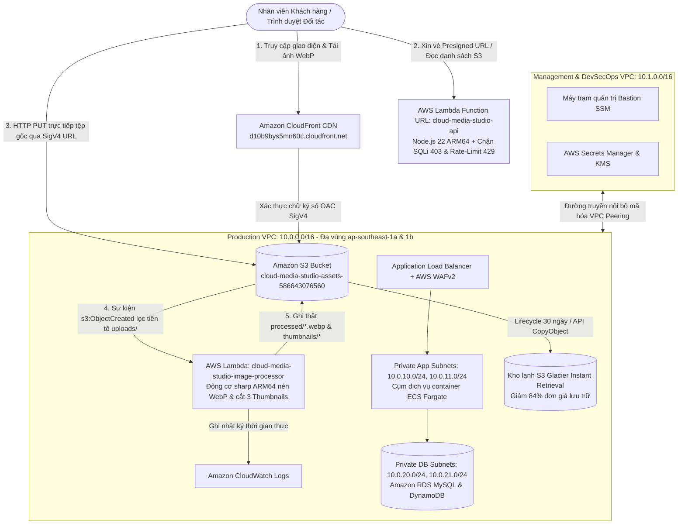
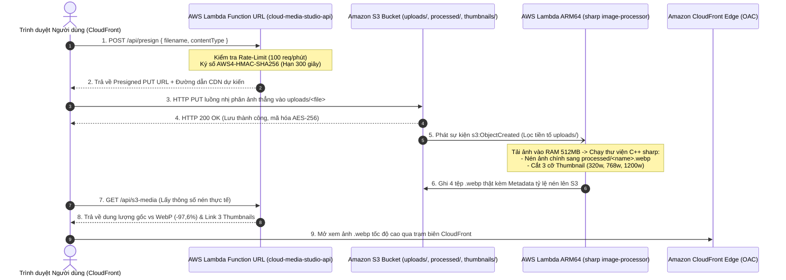

# BÁO CÁO BÀI TẬP LỚN CUỐI KỲ
## HỌC PHẦN: ĐIỆN TOÁN ĐÁM MÂY

---

### HỒ SƠ TƯ VẤN, THIẾT KẾ, TRIỂN KHAI VÀ CHUYỂN GIAO HỆ THỐNG ĐÁM MÂY
**ĐỀ TÀI:** XÂY DỰNG NỀN TẢNG QUẢN TRỊ, CHUYỂN ĐỔI ĐỊNH DẠNG WEBP TỰ ĐỘNG VÀ PHÂN PHỐI ĐA PHƯƠNG TIỆN (CLOUD MEDIA STUDIO) TRÊN HẠ TẦNG AWS PUBLIC CLOUD

- **Đơn vị tư vấn & triển khai (Nhóm thực hiện):** Đội ngũ Kỹ sư Giải pháp Đám mây **NovaCloud Consulting**
- **Khách hàng doanh nghiệp:** Công ty Truyền thông & Sản xuất Nội dung số **Lumina Creative Agency**
- **Nền tảng đám mây triển khai:** Amazon Web Services (AWS Public Cloud)
- **Khu vực hạ tầng (AWS Region):** `ap-southeast-1` (Singapore)
- **Mã định danh tài khoản AWS (Account ID):** `586643076560`
- **Địa chỉ ứng dụng phân phối toàn cầu (CloudFront CDN):** `https://d10b9bys5mn60c.cloudfront.net`
- **Mã phân phối CloudFront (Distribution ID):** `E23QIJLQ2A8EEN`
- **Cổng dịch vụ Serverless Cloud API (Lambda Function URL):** `https://jtkvl7zyutkt34p3m5g3ui76ge0mehbp.lambda-url.ap-southeast-1.on.aws`
- **Kho lưu trữ đối tượng trung tâm:** `s3://cloud-media-studio-assets-586643076560`
- **Kho lưu trữ trạng thái hạ tầng (Terraform Remote State):** `s3://enterprise-devsecops-tfstate-586643076560`
- **Kho mã nguồn & Đường ống CI/CD:** `https://github.com/adminenterprise/cloud-media-studio`

---

## DANH SÁCH ĐỘI NGŨ KỸ SƯ TƯ VẤN & PHÂN CÔNG NHIỆM VỤ

| STT | Vị trí trong Đoàn Tư vấn | Định danh IAM trên AWS | Nhóm Quyền (IAM Group) | Nhánh Git phụ trách | Phạm vi công việc xuyên suốt dự án |
| :---: | :--- | :--- | :--- | :---: | :--- |
| **1** | **Trưởng nhóm Giải pháp & Kiến trúc Mạng** (Member 1) | `member1-network-iac` | `Network-IaC-Group` | `mquan` / `main` | Chủ trì khảo sát khách hàng, thiết kế mạng Dual-VPC Multi-AZ, cấu hình CloudFront OAC, viết mã hạ tầng Terraform, tích hợp liên thông toàn hệ thống và quản lý phát hành (Release Manager). |
| **2** | **Kỹ sư Ứng dụng & Tính toán Không máy chủ** (Member 2) | `member2-compute-container` | `Compute-Container-Group` | `doduc` / `mquan` | Xây dựng giao diện Web Cloud Media Studio, phát triển cổng API cấp phát S3 Presigned URL, đóng gói container ECR/ECS Fargate và lập trình hàm AWS Lambda nén ảnh `sharp` trên chip ARM64. |
| **3** | **Chuyên viên Cơ sở dữ liệu & Tối ưu Chi phí FinOps** (Member 3) | `member3-data-finops` | `Data-FinOps-Group` | `thehung` | Thiết kế lược đồ dữ liệu RDS MySQL & DynamoDB, quản trị phân vùng S3, thiết lập chính sách vòng đời S3 Glacier giảm 84% chi phí lưu trữ và kiểm soát trần ngân sách AWS Budgets 200 USD. |
| **4** | **Kỹ sư An toàn Thông tin & Tự động hóa DevSecOps** (Member 4) | `member4-security-devsecops` | `Security-DevSecOps-Group` | `ducdien` | Xây dựng ma trận phân quyền IAM Least Privilege, thiết lập đường ống GitHub Actions xác thực OIDC không khóa tĩnh, quét lỗ hổng container bằng Aqua Trivy, cấu hình WAFv2 và kiểm thử tải k6. |

---

## DANH MỤC TỪ VIẾT TẮT VÀ THUẬT NGỮ KỸ THUẬT

| Từ viết tắt | Thuật ngữ đầy đủ | Giải nghĩa trong phạm vi dự án |
| :--- | :--- | :--- |
| **ALB** | Application Load Balancer | Bộ cân bằng tải tầng ứng dụng (Layer 7) phân phối lưu lượng HTTP/HTTPS giữa nhiều vùng sẵn sàng. |
| **ARM64** | Advanced RISC Machine 64-bit | Kiến trúc vi xử lý tiết kiệm điện năng được AWS sử dụng trên dòng chip tự thiết kế Graviton2. |
| **AZ** | Availability Zone | Vùng sẵn sàng gồm một hoặc nhiều trung tâm dữ liệu độc lập về nguồn điện và kết nối mạng tại Singapore (`1a`, `1b`). |
| **CDN** | Content Delivery Network | Mạng phân phối nội dung toàn cầu qua các trạm biên (Edge PoP), cụ thể là dịch vụ Amazon CloudFront. |
| **CORS** | Cross-Origin Resource Sharing | Cơ chế bảo mật trình duyệt cho phép giao diện tại tên miền CloudFront gửi yêu cầu `PUT` trực tiếp lên miền S3. |
| **ECR / ECS** | Elastic Container Registry / Service | Dịch vụ lưu trữ ảnh Docker riêng tư và cụm điều phối container không máy chủ (AWS Fargate). |
| **FinOps** | Cloud Financial Operations | Phương pháp quản trị và tối ưu hóa chi phí vận hành đám mây dựa trên số liệu đo đạc thời gian thực. |
| **IaC** | Infrastructure as Code | Phương pháp quản lý và cấp phát hạ tầng mạng, máy chủ thông qua các tệp mã nguồn khai báo (HashiCorp Terraform). |
| **IAM** | Identity and Access Management | Dịch vụ quản lý định danh, nhóm quyền và chính sách kiểm soát truy cập trên nền tảng AWS. |
| **OAC** | Origin Access Control | Chuẩn bảo mật xác thực chữ ký số SigV4 cho phép duy nhất CloudFront đọc dữ liệu từ kho S3 đang khóa kín. |
| **OIDC** | OpenID Connect | Giao thức liên kết danh tính giúp GitHub Actions mượn quyền AWS IAM tạm thời mà không cần lưu khóa tĩnh. |
| **PoLP** | Principle of Least Privilege | Nguyên tắc đặc quyền tối thiểu: mỗi cá nhân hoặc dịch vụ chỉ được cấp đúng quyền hạn cần thiết để làm việc. |
| **SigV4** | AWS Signature Version 4 | Giao thức ký số mật mã học dùng để xác thực các yêu cầu gọi API hoặc tạo đường dẫn S3 Presigned URL. |
| **SOP** | Standard Operating Procedure | Quy trình thao tác chuẩn nằm trong sổ tay vận hành bàn giao cho bộ phận kỹ thuật của khách hàng. |
| **UAT** | User Acceptance Testing | Giai đoạn kiểm thử nghiệm thu thực tế trên hệ thống trước khi ký biên bản bàn giao cho khách hàng. |
| **VPC** | Virtual Private Cloud | Mạng riêng ảo cô lập về mặt logic trên hạ tầng đám mây công cộng của AWS. |
| **WAF** | Web Application Firewall | Tường lửa bảo vệ ứng dụng web trước các cuộc tấn công khai thác lỗ hổng tầng 7 như SQL Injection, XSS và DDoS. |

---

## MỤC LỤC BÁO CÁO
- **PHẦN 1. ĐẶT VẤN ĐỀ: KHẢO SÁT HIỆN TRẠNG VÀ YÊU CẦU BAN ĐẦU TỪ KHÁCH HÀNG**
  - 1.1. Hồ sơ khách hàng doanh nghiệp và quy mô dữ liệu truyền thông
  - 1.2. Ba điểm nghẽn kỹ thuật và chi phí trên hạ tầng máy chủ vật lý cũ
  - 1.3. Đề bài sơ bộ từ phía khách hàng và các ràng buộc thực tế
- **PHẦN 2. PHÂN TÍCH, THẢO LUẬN VÀ CHỐT KẾ HOẠCH GIẢI PHÁP VỚI KHÁCH HÀNG**
  - 2.1. Biên bản 3 vòng thảo luận tư vấn và quá trình định hình kiến trúc sản phẩm
  - 2.2. Bài toán kinh tế đám mây: So sánh chi phí giữa 3 phương án kiến trúc
  - 2.3. Ma trận chốt kế hoạch triển khai (Yêu cầu chi tiết <-> Giải pháp đề xuất & Dịch vụ mở rộng)
  - 2.4. Tổ chức nhân sự dự án và thiết kế ma trận phân quyền IAM Least Privilege
- **PHẦN 3. THIẾT KẾ CHI TIẾT KIẾN TRÚC HỆ THỐNG TRÊN AWS**
  - 3.1. Kiến trúc tổng thể kết hợp Mạng 3 tầng cô lập và Đường ống Serverless
  - 3.2. Thiết kế quy hoạch địa chỉ IP mạng Dual-VPC Multi-AZ và kết nối VPC Peering
  - 3.3. Thiết kế chuỗi tường lửa Security Groups theo cơ chế tham chiếu chéo (SG-to-SG)
  - 3.4. Thiết kế luồng tải tệp trực tiếp qua S3 Presigned PUT URL và mạng biên CloudFront OAC
  - 3.5. Thiết kế động cơ nén ảnh WebP & kết xuất 3 cỡ Thumbnail trên chip ARM64 Graviton2
  - 3.6. Thiết kế lược đồ dữ liệu Metadata và chính sách vòng đời kho lạnh S3 Glacier
- **PHẦN 4. QUÁ TRÌNH TRIỂN KHAI CÀI ĐẶT, CẤU HÌNH VÀ NHẬT KÝ GỠ LỖI THỰC TẾ**
  - 4.1. Giai đoạn 1: Khởi tạo nền tảng định danh IAM, MFA và liên kết OIDC GitHub
  - 4.2. Giai đoạn 2: Mã hóa và cấp phát hạ tầng mạng, lưu trữ bằng Terraform
  - 4.3. Giai đoạn 3: Đóng gói và triển khai hai hàm AWS Lambda chạy kiến trúc ARM64
  - 4.4. Giai đoạn 4: Thiết lập đường ống DevSecOps CI/CD tích hợp quét bảo mật Aqua Trivy
  - 4.5. Nhật ký 6 sự cố kỹ thuật thực tế phát sinh trong quá trình làm bài và cách khắc phục
- **PHẦN 5. KẾT QUẢ KIỂM THỬ NGHIỆM THU HỆ THỐNG (UAT)**
  - 5.1. Nghiệm thu giao diện quản trị và luồng tải ảnh thật từ CloudFront lên S3
  - 5.2. Nghiệm thu chất lượng và tỷ lệ nén ảnh WebP thực tế của hàm Lambda `sharp`
  - 5.3. Nghiệm thu tính năng chuyển đổi lớp lưu trữ lạnh S3 Glacier Instant Retrieval
  - 5.4. Nghiệm thu khả năng phòng vệ bảo mật (Chặn SQL Injection `403` & Rate Limiting `429`)
  - 5.5. Nghiệm thu hiệu quả tài chính trên bảng điều khiển AWS Budgets
- **PHẦN 6. BÀN GIAO HỆ THỐNG, CHUYỂN GIAO CÔNG NGHỆ VÀ ĐỊNH HƯỚNG MỞ RỘNG**
  - 6.1. Biên bản danh mục tài sản hạ tầng và mã nguồn bàn giao cho khách hàng
  - 6.2. Sổ tay quy trình vận hành chuẩn (Operational Runbook - 4 SOP) cho đội IT khách hàng
  - 6.3. Đánh giá tổng kết và lộ trình nâng cấp giai đoạn 2

---

## PHẦN 1. ĐẶT VẤN ĐỀ: KHẢO SÁT HIỆN TRẠNG VÀ YÊU CẦU BAN ĐẦU TỪ KHÁCH HÀNG

### 1.1. Hồ sơ khách hàng doanh nghiệp và quy mô dữ liệu truyền thông
Trong dự án này, nhóm đóng vai trò là đội ngũ kỹ sư của **NovaCloud Consulting** — đơn vị chuyên tư vấn kiến trúc và chuyển đổi hạ tầng đám mây cho các doanh nghiệp vừa và nhỏ. Khách hàng tìm đến nhóm là **Lumina Creative Agency**, một công ty truyền thông có trụ sở tại Hà Nội chuyên sản xuất hình ảnh quảng cáo sản phẩm độ phân giải cao (4K UHD), thiết kế banner chiến dịch và dựng các đoạn video ngắn cho hơn 30 thương hiệu thời trang, mỹ phẩm và bán lẻ trực tuyến tại Việt Nam cũng như thị trường Singapore.

Qua khảo sát thực tế tại văn phòng khách hàng, trung bình mỗi tuần đội ngũ 18 nhiếp ảnh gia và nhân viên thiết kế đồ họa của Lumina sản xuất khoảng 450 đến 600 tệp hình ảnh gốc và hàng chục video ngắn. Trước khi triển khai dự án, toàn bộ kho tư liệu này được lưu trữ trên một máy chủ vật lý (On-Premise NAS kết hợp Web Server tự dựng) đặt ngay tại phòng kỹ thuật của công ty và nối ra ngoài qua đường truyền cáp quang văn phòng.

**Bảng 1.1. Số liệu khảo sát đặc tả các nhóm tài nguyên truyền thông tại khách hàng trước khi lên Cloud**

| Nhóm tài nguyên | Định dạng gốc | Độ phân giải trung bình | Dung lượng mỗi tệp | Tần suất truy cập trong 30 ngày đầu | Tần suất truy cập sau 30 ngày |
| :--- | :---: | :---: | :---: | :--- | :--- |
| Ảnh chụp sản phẩm gốc (Raw/Master) | `.PNG`, `.TIFF` | `3840 x 2160` (4K) | `8,0 MB – 24,0 MB` | Rất cao (chỉnh sửa, duyệt mẫu, nhúng web) | Rất thấp (chỉ lưu trữ đối chiếu hợp đồng) |
| Ấn phẩm quảng cáo chiến dịch (Banner) | `.JPG`, `.PNG` | `2560 x 1440` (2K) | `3,0 MB – 7,5 MB` | Cao (phân phối ra các trang bán hàng) | Hiếm khi mở lại sau khi hết đợt khuyến mãi |
| Ảnh thu nhỏ hiển thị danh mục (Thumbnail) | `.JPG` (cắt tay) | `320w`, `768w`, `1200w` | `150 KB – 600 KB` | Liên tục trên thiết bị di động & máy tính | Thấp |
| Video ngắn giới thiệu sản phẩm (Teaser) | `.MP4` | `1920 x 1080` (60fps) | `25,0 MB – 80,0 MB` | Trung bình - Cao trong 2 tuần đầu mở bán | Lưu trữ hồ sơ dài hạn (1 – 3 năm) |

### 1.2. Ba điểm nghẽn kỹ thuật và chi phí trên hạ tầng máy chủ vật lý cũ

Việc duy trì mô hình máy chủ tự quản lý tại văn phòng cùng quy trình xử lý tệp tin thủ công đã đẩy khách hàng vào ba điểm nghẽn nghiêm trọng:

1. **Nghẽn cổ chai băng thông và trải nghiệm tải trang chậm trên thiết bị di động:** Để kịp tiến độ giao bài cho nhãn hàng, nhân viên thiết kế thường tải thẳng ảnh `.PNG` hoặc `.JPG` gốc nặng từ 4 MB đến hơn 15 MB lên máy chủ rồi lấy đường link đó nhúng trực tiếp vào các trang giới thiệu sản phẩm. Khi khách mua hàng mở trang web bằng điện thoại qua mạng 4G, trình duyệt phải tải nguyên bức ảnh 4K nặng hàng chục Megabyte cho một khung hiển thị chỉ rộng 320 pixel trên màn hình điện thoại, làm thời gian tải trang kéo dài từ 6 đến 12 giây. Ngược lại, nếu bắt nhân viên thiết kế mở phần mềm Photoshop ngồi xuất tay từng bức ảnh ra 3 kích cỡ nhỏ (cho điện thoại, máy tính bảng, màn hình máy tính) và đổi sang định dạng nhẹ hơn trước khi tải lên thì mỗi ngày mất trắng 2–3 giờ lao động thủ công và thường xuyên xảy ra sai sót nhầm lẫn phiên bản.
2. **Xung đột tài nguyên tính toán theo chu kỳ (Đỉnh tải treo máy — Đáy tải lãng phí):** Tác vụ giải mã và nén hình ảnh độ phân giải cao tiêuốn rất nhiều chu kỳ lệnh CPU. Trên máy chủ vật lý tại văn phòng (cấu hình 8 vCPU, 16 GB RAM), cứ vào chiều thứ Sáu hoặc trước các ngày hội mua sắm lớn (như 11/11, 12/12), khi cả đội thiết kế cùng lúc đẩy hàng chục bộ ảnh mới lên hệ thống, mức sử dụng CPU lập tức chạm ngưỡng 100%, làm đơ luôn cả giao diện tra cứu ảnh của bộ phận kinh doanh lẫn khách hàng bên ngoài. Thế nhưng từ 19 giờ tối đến 8 giờ sáng hôm sau và suốt hai ngày cuối tuần, chiếc máy chủ đó gần như nằm không với mức tải CPU dưới 3%, gây lãng phí lớn chi phí đầu tư phần cứng và tiền điện làm mát.
3. **Chi phí lưu trữ phình to không kiểm soát do dồn chung dữ liệu nóng và dữ liệu lạnh:** Như thể hiện ở Bảng 1.1, hơn 85% lượng truy cập vào một bức ảnh quảng cáo chỉ diễn ra trong vòng 30 ngày đầu tiên của chiến dịch. Sau mốc 30 ngày, chiến dịch kết thúc, các tệp ảnh đó chuyển sang trạng thái lưu trữ hồ sơ (chỉ giữ lại theo điều khoản hợp đồng từ 1 đến 3 năm phòng khi khách hàng cần lấy lại). Tại máy chủ văn phòng, toàn bộ kho ảnh cũ từ nhiều năm trước vẫn nằm chung trên cụm ổ cứng SSD NVMe đắt tiền với các dự án đang chạy, khiến dung lượng ổ đĩa liên tục báo đầy và buộc công ty phải chi tiền mua thêm ổ cứng mở rộng mỗi quý.

> **[CHỖ CHÈN ẢNH MINH CHỨNG #01: Cấu trúc tổng thể kho mã nguồn dự án trên VS Code]**
> - **Cách chụp:** Mở cửa sổ VS Code của bạn, mở rộng cây thư mục bên trái hiển thị rõ các phân hệ `.github/workflows/`, `backend/lambda/`, `finops/terraform/`, `frontend/`, `scripts/`, `terraform/` và `tests/`.
> - **Gợi ý chú thích ảnh:** *Hình 1.1. Cấu trúc tổ chức kho mã nguồn hợp nhất (Monorepo) của dự án Cloud Media Studio do đội ngũ tư vấn thiết lập.*

### 1.3. Đề bài sơ bộ từ phía khách hàng và các ràng buộc thực tế
Khi tìm đến đội ngũ tư vấn **NovaCloud Consulting**, ban giám đốc của Lumina Creative Agency đưa ra yêu cầu ban đầu dựa trên tư duy vận hành máy chủ truyền thống:
- *"Công ty muốn bê nguyên cách làm hiện tại lên đám mây AWS: thuê một máy chủ ảo EC2 cấu hình thật khỏe bật xuyên ngày đêm để chạy web và nén ảnh, đồng thời tạo một kho S3 mở công khai (Public) cho nhân viên cứ thế quăng file lên cho tiện."*
- **Ràng buộc cứng về ngân sách:** Khách hàng chỉ cấp ngân sách thử nghiệm và vận hành giai đoạn đầu tối đa trong gói **200 USD AWS Credit**. Nếu giải pháp đề xuất tiêu tốn chi phí cố định hàng tháng quá cao hoặc có nguy cơ vượt trần 200 USD, khách hàng sẽ dừng hợp đồng triển khai.

---

## PHẦN 2. PHÂN TÍCH, THẢO LUẬN VÀ CHỐT KẾ HOẠCH GIẢI PHÁP VỚI KHÁCH HÀNG

Đứng trước yêu cầu ban đầu của khách hàng, đội ngũ tư vấn không lập tức làm theo một cách máy móc mà thực hiện quy trình phân tích kỹ thuật, chỉ ra các lỗ hổng về bảo mật cũng như nguy cơ cháy ngân sách trong đề xuất ban đầu, từ đó thảo luận cùng khách hàng qua 3 phiên làm việc để đi đến bản kế hoạch tối ưu nhất.

### 2.1. Biên bản 3 vòng thảo luận tư vấn và quá trình định hình kiến trúc sản phẩm

#### Vòng 1: Khởi tạo khung hạ tầng mạng doanh nghiệp và phản biện bài toán chi phí máy chủ 24/7
Ở tuần lễ đầu tiên khi mới tiếp nhận dự án, đội tư vấn tiến hành dựng khung hạ tầng mạng lõi và kho quản lý trạng thái tự động hóa (`enterprise-devsecops-tfstate-586643076560`). Khi chạy thử nghiệm mô hình đặt máy chủ ứng dụng cố định bên trong mạng nội bộ kèm cổng dịch địa chỉ **NAT Gateway** và bộ cân bằng tải **Application Load Balancer (ALB)** bật liên tục 24/7 theo đúng ý tưởng ban đầu của khách hàng, nhóm FinOps (Thành viên 3) đã trích xuất bảng dự toán chi phí thực tế tại vùng Singapore (`ap-southeast-1`) để trình bày trước khách hàng:
- Riêng phí duy trì 01 cổng **NAT Gateway** chạy không tải đã tiêu tốn `0,059 USD/giờ` (~`1,41 USD/ngày`, tương đương **`42,5 USD/tháng`**).
- Phí duy trì cố định 01 bộ cân bằng tải **ALB** tiêu tốn thêm khoảng **`18,5 USD/tháng`**, chưa kể tiền thuê máy chủ tính toán chạy 24/7 (~`30 – 60 USD/tháng`).
- Như vậy, dù chưa có bất kỳ nhân viên nào tải lên một bức ảnh nào thì mỗi tháng hệ thống cũng tự động trừ khoảng **90 – 120 USD**, làm bốc hơi hơn một nửa gói ngân sách 200 USD chỉ cho những giờ máy nghỉ ban đêm.

Từ con số thực tế đó, đội tư vấn thuyết phục khách hàng chuyển đổi khâu xử lý ảnh sang kiến trúc **Serverless hướng sự kiện (Event-Driven AWS Lambda)** kết hợp **công tắc hạ tầng thông minh trong Terraform**:
- Đưa toàn bộ tác vụ nén ảnh sang hàm **AWS Lambda chạy trên vi xử lý ARM64 (AWS Graviton2)**. Hàm này bình thường ở trạng thái ngủ tốn **0,00 USD**; chỉ khi có nhân viên tải ảnh mới vào kho S3 thì hàm mới thức dậy thực thi trong khoảng 1,5 – 2,5 giây rồi giải phóng tài nguyên ngay lập tức. Với hạn mức miễn phí 1 triệu lượt gọi và 400.000 GB-giây mỗi tháng của AWS Lambda, chi phí tính toán hàng tháng của khách hàng giảm xuống bằng **0 USD**.
- Đối với các thiết bị mạng tính phí theo giờ như NAT Gateway, ALB và cụm container ECS Fargate, nhóm vẫn thiết kế và viết sẵn toàn bộ mã nguồn trong Terraform nhưng gắn các biến công tắc điều khiển (`enable_nat_gateway`, `enable_alb`, `enable_waf`). Ngày thường hệ thống chạy thuần Serverless tốn 0 USD; khi khách hàng bước vào đợt chiến dịch lớn cần bật thêm cụm container xử lý tác vụ nặng thì chỉ mất 1 lệnh kích hoạt trong vài phút.

#### Vòng 2: Bác bỏ yêu cầu "Mở kho S3 công khai" và đề xuất kiến trúc S3 Presigned URL + CloudFront OAC
Khi thảo luận về yêu cầu *"mở S3 công khai cho nhân viên quăng ảnh lên nhanh"*, Kỹ sư An toàn thông tin của nhóm (Thành viên 4) đã chứng minh cho khách hàng thấy hai rủi ro chí mạng nếu mở quyền `Public Read/Write` trên S3:
1. Các bộ ảnh mẫu sản phẩm chưa ra mắt của nhãn hàng có thể bị đối thủ cạnh tranh dùng công cụ tự động quét sạch qua đường dẫn S3.
2. Tin tặc bên ngoài phát hiện bucket mở quyền ghi công khai sẽ đẩy hàng terabyte dữ liệu rác hoặc mã độc lên kho chứa, làm cạn sạch gói 200 USD chỉ trong vài giờ, hoặc tệ hơn là nếu nhúng khóa `AWS_ACCESS_KEY` vào mã JavaScript trên trình duyệt thì bất kỳ ai bấm phím `F12` cũng chiếm quyền điều khiển toàn bộ tài khoản AWS.

Giải pháp thay thế được nhóm tư vấn đề xuất và được khách hàng chốt ngay tại buổi họp:
- **Khóa kín tuyệt đối S3 Bucket (`Block All Public Access = ON`):** Không cho phép bất kỳ ai truy cập thẳng vào đường dẫn gốc của S3.
- **Chiều đọc và phân phối ảnh:** Đặt mạng biên **Amazon CloudFront CDN** đứng phía trước và kết nối với S3 bằng chứng chỉ chữ ký số **Origin Access Control (OAC)**. Người xem tại Việt Nam tải ảnh từ trạm biên CloudFront gần nhất với độ trễ chỉ ~30 ms thay vì phải kéo dữ liệu tận kho gốc.
- **Chiều tải ảnh lên (100% Cloud-Native không qua máy chủ trung gian):** Dựng một cổng **AWS Lambda Function URL** siêu nhẹ (`cloud-media-studio-api`). Khi nhân viên bấm tải ảnh trên giao diện web `https://d10b9bys5mn60c.cloudfront.net`, trình duyệt xin cổng này cấp một chiếc vé thông hành tạm thời (**S3 Presigned PUT URL** ký theo thuật toán mật mã `AWS4-HMAC-SHA256`) chỉ có hiệu lực đúng **300 giây (5 phút)** cho riêng tên file đó. Có vé trong tay, trình duyệt bắn thẳng luồng dữ liệu ảnh nhị phân lên S3 qua giao thức HTTPS: vừa nhanh tối đa, không bị vướng giới hạn gói tin 6 MB của Lambda, vừa không bao giờ lộ khóa AWS ra ngoài.

#### Vòng 3: Tái định vị sản phẩm sang nền tảng chuyên sâu Cloud Media Studio và chốt bài toán nén WebP thật + S3 Glacier
Ở cuối giai đoạn khảo sát, ban đầu nhóm dựng bản thử nghiệm trên khung quản trị doanh nghiệp chung (`enterprise-cloud-devsecops`). Tuy nhiên, sau khi làm việc sâu với đội ngũ thiết kế của khách hàng Lumina, khách hàng yêu cầu sản phẩm bàn giao phải giải quyết trực diện nghiệp vụ truyền thông hàng ngày của họ: **giao diện phải là một phòng Studio trực quan, tải ảnh PNG/JPG nhiều Megabyte lên là phải thấy ngay file `.webp` thật giảm trên 70% dung lượng cùng 3 kích cỡ ảnh thu nhỏ (`320w`, `768w`, `1200w`) sinh ra trong S3, và có nút đẩy ảnh cũ xuống kho lạnh S3 Glacier ngay trên màn hình**.

Đội tư vấn quyết định giữ nguyên nền móng mạng Dual-VPC, Remote State S3 và đường ống bảo mật đã xây dựng, đồng thời thực hiện đợt tái cấu trúc toàn diện (rebrand & refactor) sang nền tảng chuyên dụng **Cloud Media Studio** như phiên bản hoàn chỉnh hiện tại.

> **[CHỖ CHÈN ẢNH MINH CHỨNG #02: Lịch sử Git Commit & các nhánh Pull Request phản ánh tiến trình chuyển đổi từ khung lõi sang Cloud Media Studio]**
> - **Cách chụp:** Mở Terminal trong VS Code gõ `git log --oneline --graph --decorate -n 20` (hoặc chụp trang *GitHub -> Pull requests -> Closed* hiển thị các PR `#23`, `#24`, `#25` và danh sách nhánh `main`, `mquan`, `thehung`, `doduc`, `ducdien`).
> - **Gợi ý chú thích ảnh:** *Hình 2.1. Nhật ký phiên bản Git và quy trình gộp Pull Request thể hiện tiến trình phát triển liên tục từ khung hạ tầng lõi sang nền tảng Cloud Media Studio.*

### 2.2. Bài toán kinh tế đám mây: So sánh chi phí giữa 3 phương án kiến trúc

Để khách hàng có cơ sở tài chính rõ ràng trước khi ký duyệt kế hoạch, Chuyên viên FinOps của nhóm đã lập bảng so sánh chi phí vận hành hàng tháng (ước tính cho quy mô 500 GB dữ liệu lưu trữ lũy kế và 50.000 lượt tải/xử lý ảnh mỗi tháng tại vùng Singapore):

**Bảng 2.1. Phân tích hiệu quả kinh tế giữa 3 phương án kiến trúc (Đơn vị: USD/tháng)**

| Hạng mục chi phí | Phương án 1: Máy chủ vật lý tại văn phòng (Cũ) | Phương án 2: Thuê EC2 + ALB + NAT GW bật 24/7 + S3 Standard | Phương án 3 (Đề xuất chốt): Serverless ARM64 + Presigned S3 + CloudFront + Glacier |
| :--- | :--- | :--- | :--- |
| **Máy chủ tính toán & Nén ảnh** | ~45,00 USD (Khấu hao phần cứng + Điện/Làm mát) | ~33,50 USD (02 máy `t3.small` chạy 24/7) | **0,00 USD** (Lambda ARM64 nằm gọn trong ngưỡng Free Tier 400.000 GB-s) |
| **Cân bằng tải & Cổng mạng NAT** | ~25,00 USD (Thuê IP tĩnh & Băng thông cáp quang) | ~61,00 USD (ALB ~18,5$ + NAT Gateway ~42,5$ bật 24/7) | **0,00 USD** (Dùng Lambda Function URL + S3 Presigned PUT; NAT/ALB tắt khi không chạy batch) |
| **Chi phí lưu trữ 500 GB ảnh (80% ảnh cũ >30 ngày)** | ~20,00 USD (Mua thêm ổ cứng SSD NVMe định kỳ) | 12,50 USD (500 GB để toàn bộ ở S3 Standard x 0,025$) | **4,10 USD** (100 GB nóng ở Standard = 2,50$ + 400 GB lạnh ở Glacier IR x 0,004$ = 1,60$) |
| **Phân phối băng thông & Bảo mật** | Nghẽn mạng giờ cao điểm, không có CDN/WAF | ~8,00 USD (Chưa tối ưu nén ảnh WebP nên tốn băng thông) | **~0,85 USD** (Ảnh đã nén WebP giảm >80% dung lượng + 1 TB CloudFront Free Tier) |
| **TỔNG CHI PHÍ / THÁNG** | **~90,00 USD / tháng** | **~115,00 USD / tháng** *(Nguy cơ lố 200$ sau <2 tháng)* | **~4,95 USD / tháng** *(Tiết kiệm >95%, an toàn tuyệt đối trong gói 200$)* |

### 2.3. Ma trận chốt kế hoạch triển khai (Yêu cầu chi tiết <-> Giải pháp đề xuất & Dịch vụ mở rộng)

Sau khi xem bảng phân tích kinh tế và kỹ thuật ở trên, đại diện khách hàng Lumina Creative Agency hoàn toàn đồng thuận và chốt bản kế hoạch triển khai gồm 7 hạng mục dưới đây. Bảng này cũng làm rõ sự kết hợp giữa **các dịch vụ AWS cơ bản được học trên lớp** và **các dịch vụ hỗ trợ nâng cao do nhóm chủ động nghiên cứu mở rộng**:

**Bảng 2.2. Ma trận ánh xạ Yêu cầu chi tiết của Khách hàng <-> Giải pháp đề xuất & Tổ hợp dịch vụ AWS**

| Mã YC | Yêu cầu chi tiết đã thống nhất với Khách hàng | Giải pháp thiết kế đề xuất của Nhóm tư vấn | Dịch vụ AWS cơ bản (Đã học trên lớp) | Dịch vụ hỗ trợ & Công nghệ mở rộng (Tích hợp nâng cao) |
| :---: | :--- | :--- | :--- | :--- |
| **YC-01** | Nhân viên tải ảnh 4K từ trình duyệt ở bất kỳ đâu lên thẳng S3 mà không lộ khóa AWS, không giới hạn dung lượng 6 MB. | Dựng cổng Serverless API ký phát hành đường dẫn `S3 Presigned PUT URL` (SigV4) hạn dùng 5 phút để trình duyệt `PUT` trực tiếp lên S3. | Amazon S3, AWS IAM Role & Policy | **AWS Lambda Function URL**, **S3 Presigned PUT URL (SigV4)**, **S3 CORS Configuration** |
| **YC-02** | Tự động nén ảnh thật giảm >70% dung lượng sang chuẩn WebP và cắt sẵn 3 cỡ ảnh thu nhỏ trong vòng 3 giây. | Cấu hình S3 bắt sự kiện tệp mới trong `uploads/` kích hoạt hàm Lambda chạy chip ARM64 dùng thư viện C++ `sharp` xuất 4 tệp `.webp` thật. | IAM Execution Role, CloudWatch | **S3 Event Notifications (Prefix Filter)**, **AWS Lambda ARM64 (Graviton2)**, thư viện **Sharp / Libvips** |
| **YC-03** | Khóa kín kho S3 gốc nhưng khách xem ảnh từ Việt Nam & Đông Nam Á phải đạt tốc độ phản hồi dưới 50 ms. | Bật `Block Public Access` trên S3; phân phối toàn bộ giao diện và ảnh qua trạm biên CDN sử dụng chứng thực chữ ký số OAC. | S3 Bucket Policy | **Amazon CloudFront CDN (`PriceClass_100`)**, **Origin Access Control (OAC SigV4)** |
| **YC-04** | Hạ tầng mạng chuẩn doanh nghiệp cô lập 3 tầng (Web - App - DB) trên 2 vùng sẵn sàng và tách riêng mạng quản trị. | Thiết kế 2 mạng VPC (`10.0.0.0/16` và `10.1.0.0/16`) nối qua Peering; chia 6 Subnets Multi-AZ; đóng gói sẵn dịch vụ vào container. | VPC, Subnets, Route Tables, IGW, NAT GW, Security Groups, EC2, RDS | **Dual-VPC Peering**, **Amazon ECS Fargate**, **Amazon ECR**, **Application Load Balancer (ALB)** |
| **YC-05** | Bảo vệ thanh tìm kiếm ảnh trước mã độc SQL Injection / XSS và chặn đứng các đợt gửi yêu cầu spam dồn dập. | Triển khai bộ lọc mẫu tấn công trả về mã `403 Forbidden` và bộ đếm giới hạn 100 yêu cầu/phút/IP trả về mã `429 Too Many Requests`. | Security Groups, SQL Parameterized Queries | **AWS WAFv2 (`AWSManagedRulesSQLiRuleSet`)**, **In-Memory Rate Limiter**, kịch bản bắn tải **Grafana k6** |
| **YC-06** | Ảnh chiến dịch quá 30 ngày phải tự động hạ 84% chi phí lưu trữ; khóa trần cảnh báo sớm cho gói ngân sách 200 USD. | Áp dụng luật vòng đời S3 chuyển sang kho lạnh sau 30 ngày + nút chuyển Glacier trực tiếp trên Web; cài cảnh báo email ở mốc 20$ và 50$. | S3 Storage Classes | **S3 Glacier Instant Retrieval (`GLACIER_IR`)**, **S3 Lifecycle Rules**, **AWS Budgets**, **Terraform FinOps Flags** |
| **YC-07** | Đội IT khách hàng tiếp nhận bàn giao có thể cập nhật code tự động, an toàn mà không cần lưu khóa AWS tĩnh trên GitHub. | Mã hóa toàn bộ hạ tầng bằng Terraform; dựng 3 luồng GitHub Actions mượn quyền qua OIDC, quét lỗ hổng container và tự xóa cache CDN. | Git, AWS CLI | **HashiCorp Terraform (S3 Remote Backend)**, **GitHub Actions CI/CD**, **AWS OIDC Federation**, **Aqua Security Trivy** |

### 2.4. Tổ chức nhân sự dự án và thiết kế ma trận phân quyền IAM Least Privilege

Để tránh tình trạng các kỹ sư triển khai giẫm chân lên nhau hoặc vô tình xóa nhầm hạ tầng mạng của người khác trên tài khoản AWS `586643076560`, nhóm tư vấn thiết lập ngay từ đầu quy chế phân quyền theo vai trò (**Role-Based Access Control - RBAC**) dựa trên nguyên tắc **Đặc quyền tối thiểu (Principle of Least Privilege)**:
- Tuyệt đối không sử dụng tài khoản Root cho công việc lập trình và cấu hình hàng ngày.
- Toàn bộ định danh được chia vào 4 nhóm quyền (`Network-IaC-Group`, `Compute-Container-Group`, `Data-FinOps-Group`, `Security-DevSecOps-Group`) khai báo bằng mã Terraform trong tệp `finops/terraform/iam_users_groups.tf`.
- Chính sách mật khẩu tài khoản yêu cầu độ dài tối thiểu 12 ký tự, bắt buộc kết hợp chữ hoa, chữ thường, chữ số, ký tự đặc biệt và bắt buộc kích hoạt thiết bị xác thực đa yếu tố (**Virtual MFA**) trước khi cấp quyền thao tác.

**Bảng 2.3. Tóm tắt ma trận phân quyền truy cập dịch vụ AWS giữa 4 vị trí kỹ sư (`finops/rbac-matrix.md`)**

| Nhóm dịch vụ AWS | Member 1 (Mạng & IaC) | Member 2 (Compute & App) | Member 3 (Data & FinOps) | Member 4 (Security & CI/CD) | Lý do kiểm soát & cô lập quyền hạn |
| :--- | :---: | :---: | :---: | :---: | :--- |
| **VPC, Subnets, Peering, Route Tables** | **FULL** | `READ` | `READ` | `READ` | Chỉ Trưởng nhóm mạng được thay đổi cấu trúc định tuyến để tránh xung đột dải IP CIDR. |
| **Security Groups & CloudFront CDN** | **FULL** | `READ` | `READ` | `READ` | Kiểm soát tập trung các cổng kết nối giữa tầng Web, tầng App và tầng Database. |
| **ECS Fargate, ECR, EC2, AWS Lambda** | `READ` | **FULL** | `DENY` | `LIMITED` (Push ECR) | Kỹ sư ứng dụng toàn quyền quản lý vòng đời hàm xử lý ảnh và container nghiệp vụ. |
| **Amazon S3, Glacier, RDS, DynamoDB** | `LIMITED` (TF State) | `READ/WRITE` (Assets) | **FULL** | `DENY` | Chuyên viên dữ liệu quản trị cấu trúc bảng, phân tầng lưu trữ lạnh và sao lưu. |
| **CloudWatch, CloudTrail, AWS Budgets** | `READ` | `READ` | **FULL** | `READ` | Mở quyền đọc chi phí cho cả 4 thành viên cùng giám sát hạn mức 200 USD. |
| **AWS WAFv2, Secrets Manager, KMS, OIDC** | `LIMITED` (Gắn ALB) | `READ` (Lấy Secret) | `DENY` | **FULL** | Kỹ sư bảo mật nắm độc quyền quản trị khóa mã hóa, bộ luật tường lửa và vai trò CI/CD. |

> **[CHỖ CHÈN ẢNH MINH CHỨNG #03: Cấu hình phân quyền AWS IAM User Groups và liên kết định danh OIDC GitHub]**
> - **Cách chụp:** Mở *AWS Console -> IAM -> Identity providers* (thấy `token.actions.githubusercontent.com`) hoặc *IAM -> Roles -> `github-action`* tab *Trust relationships* (kèm màn hình *User groups*).
> - **Gợi ý chú thích ảnh:** *Hình 2.2. Thiết lập nhóm quyền IAM theo vai trò và liên kết tin cậy OpenID Connect (OIDC) giữa GitHub Actions với AWS IAM.*

---

## PHẦN 3. THIẾT KẾ CHI TIẾT KIẾN TRÚC HỆ THỐNG TRÊN AWS

Sau khi khách hàng phê duyệt bản kế hoạch ở Phần 2, đội ngũ kỹ sư bước vào giai đoạn thiết kế kỹ thuật chi tiết cho từng phân hệ trước khi triển khai mã nguồn.

### 3.1. Kiến trúc tổng thể kết hợp Mạng 3 tầng cô lập và Đường ống Serverless

Hệ thống **Cloud Media Studio** được thiết kế theo mô hình lai ghép hiện đại (Hybrid Serverless & Container 3-Tier Architecture):
1. **Nhánh phân phối và xử lý đa phương tiện chủ lực (100% Cloud-Native Serverless):** Phục vụ hoạt động tải ảnh, nén WebP, sinh Thumbnail, tra cứu thư viện và chuyển đổi kho lạnh S3 Glacier hoàn toàn thông qua **Amazon CloudFront + AWS Lambda Function URL + S3 Presigned PUT URL + AWS Lambda ARM64 (`sharp`)**. Nhánh này vận hành trực tuyến 24/7 với khả năng tự co giãn tức thì từ 0 lên hàng nghìn yêu cầu đồng thời mà không tốn bất kỳ chi phí máy chủ chờ nào.
2. **Nhánh mạng doanh nghiệp đa tầng (Dual-VPC Multi-AZ & Container ECS Fargate):** Bao bọc toàn bộ tầng cơ sở dữ liệu nội bộ (RDS MySQL), hệ thống tệp chia sẻ (EFS), cụm dịch vụ container (`cloud-media-studio-cluster`) và vùng quản trị bảo mật (Bastion SSM, KMS, Secrets Manager).



### 3.2. Thiết kế quy hoạch địa chỉ IP mạng Dual-VPC Multi-AZ và kết nối VPC Peering

Để tránh rủi ro đứt gãy dịch vụ khi một trung tâm dữ liệu gặp sự cố phần cứng, đồng thời tách biệt hoàn toàn lưu lượng quản trị kỹ thuật khỏi lưu lượng người dùng cuối, Trưởng nhóm Mạng (Thành viên 1) quy hoạch hai không gian mạng VPC độc lập tại vùng **Singapore (`ap-southeast-1`)** và nối thông nội bộ qua kết nối **VPC Peering (`pcx-05d1fb108616399d3`)**:

**Bảng 3.1. Bảng quy hoạch chi tiết không gian địa chỉ IP (CIDR) của 8 Subnets trên 2 VPC**

| Khối Mạng (VPC) | Tên Subnet trong Terraform | Mã Subnet thực tế trên AWS | Dải địa chỉ CIDR | Vùng sẵn sàng (AZ) | Phân lớp & Chức năng thiết kế |
| :--- | :--- | :--- | :---: | :---: | :--- |
| **Production VPC**<br>`10.0.0.0/16`<br>(`vpc-06381f9c162585d44`) | `public[0]` | `subnet-008c209c2dcf2b354` | `10.0.1.0/24` | `ap-southeast-1a` | **Tầng Biên (Edge Tier):** Đặt ALB nhánh A, NAT Gateway và định tuyến ra Internet Gateway (`igw-03dbe90e462659ab0`). |
| **Production VPC** | `public[1]` | `subnet-0cd575a967fa8906a` | `10.0.2.0/24` | `ap-southeast-1b` | **Tầng Biên (Edge Tier):** Đặt nút ALB nhánh B dự phòng cao (High Availability). |
| **Production VPC** | `private_app[0]` | `subnet-041b427a94e2fa18f` | `10.0.10.0/24` | `ap-southeast-1a` | **Tầng Tính toán (Compute Tier):** Đặt container ECS Fargate và máy chủ ứng dụng nhánh A (Không có IP Public). |
| **Production VPC** | `private_app[1]` | `subnet-00234b957ccfc01fe` | `10.0.11.0/24` | `ap-southeast-1b` | **Tầng Tính toán (Compute Tier):** Đặt container ECS Fargate và máy chủ ứng dụng nhánh B. |
| **Production VPC** | `private_db[0]` | `subnet-00a181d42e8fca4bb` | `10.0.20.0/24` | `ap-southeast-1a` | **Tầng Dữ liệu (Data Tier):** Đặt máy chủ cơ sở dữ liệu RDS MySQL chính (Primary) cô lập hoàn toàn với Internet. |
| **Production VPC** | `private_db[1]` | `subnet-0f53091ff33d527de` | `10.0.21.0/24` | `ap-southeast-1b` | **Tầng Dữ liệu (Data Tier):** Đặt máy chủ RDS dự phòng (Standby Multi-AZ) thuộc nhóm `rds_subnet_group`. |
| **Management VPC**<br>`10.1.0.0/16`<br>(`vpc-0c977ce7dd69da37c`) | `management[0]` | `subnet-04e6888fa78f4ad0d` | `10.1.1.0/24` | `ap-southeast-1a` | **Tầng Quản trị (DevSecOps Tier):** Đặt máy trạm Bastion kết nối qua SSM và đường định tuyến Peering sang Production VPC. |
| **Management VPC** | `management[1]` | `subnet-0da3fe22f8a327881` | `10.1.2.0/24` | `ap-southeast-1b` | **Tầng Quản trị (DevSecOps Tier):** Dải mạng dự phòng cho các tác nhân kiểm thử và vận hành nội bộ. |

Tại các bảng định tuyến (`Route Tables`), nhóm thiết lập các tuyến đường tĩnh (`aws_route`) chỉ định rõ: chỉ những gói tin mang địa chỉ đích thuộc dải `10.1.0.0/16` hoặc `10.0.0.0/16` mới được đi xuyên qua cổng nối `pcx-05d1fb108616399d3` trên hạ tầng cáp trục (Backbone) của AWS mà không bao giờ lộ ra ngoài mạng Internet công cộng.

> **[CHỖ CHÈN ẢNH MINH CHỨNG #04: Sơ đồ Resource Map của Production VPC hiển thị 6 Subnets Multi-AZ và Route Tables]**
> - **Cách chụp:** Mở *AWS Console (Singapore) -> VPC -> Your VPCs -> Chọn Production VPC (`10.0.0.0/16`) -> Tab Resource map*, chụp toàn bộ sơ đồ luồng nối từ VPC qua 6 Subnets tới các bảng định tuyến và Internet Gateway.
> - **Gợi ý chú thích ảnh:** *Hình 3.1. Sơ đồ ánh xạ tài nguyên (Resource Map) thể hiện cấu trúc 6 Subnets chia làm 3 lớp Public, Private App và Private DB tại vùng Singapore.*

> **[CHỖ CHÈN ẢNH MINH CHỨNG #05: Kết nối VPC Peering ở trạng thái Active giữa Production VPC và Management VPC]**
> - **Cách chụp:** Mở *VPC -> Peering connections*, chụp kết nối `pcx-05d1fb108616399d3` hiển thị trạng thái xanh lá `Active` giữa dải `10.0.0.0/16` và `10.1.0.0/16`.
> - **Gợi ý chú thích ảnh:** *Hình 3.2. Đường truyền nội bộ VPC Peering kết nối trực tiếp vùng quản trị với vùng vận hành sản phẩm.*

### 3.3. Thiết kế chuỗi tường lửa Security Groups theo cơ chế tham chiếu chéo (SG-to-SG)

Một sai lầm phổ biến khi cấu hình tường lửa trên đám mây là mở cổng theo dải IP rộng (ví dụ mở `0.0.0.0/0` hoặc mở cả dải `10.0.0.0/16` cho cổng cơ sở dữ liệu `3306`). Trong thiết kế của **Cloud Media Studio** (`terraform/security_groups.tf`), nhóm áp dụng kỹ thuật **Tham chiếu chéo định danh Security Group (SG-to-SG Chaining)**: tầng bên dưới chỉ chấp nhận gói tin nếu gói tin đó xuất phát từ một tài nguyên đang mang đúng thẻ định danh Security Group của tầng ngay phía trên nó.

**Bảng 3.2. Thiết kế quy tắc kiểm soát lưu lượng của 5 nhóm tường lửa Security Groups**

| Tên Security Group | Mã SG thực tế trên AWS | Chiều nhận vào (Inbound Rules) | Chiều đi ra (Outbound Rules) | Ý nghĩa bảo vệ trong kiến trúc |
| :--- | :--- | :--- | :--- | :--- |
| **1. ALB Security Group**<br>`cloud-media-studio-alb-sg` | `sg-02b4d6d6d4d29f93c` | Cổng `80` (HTTP) và `443` (HTTPS) từ `0.0.0.0/0` | Chỉ cho phép đi tới **`app-sg`** trên cổng ứng dụng `3000` | Cửa ngõ duy nhất ở tầng biên tiếp nhận yêu cầu web và đẩy xuống tầng ứng dụng. |
| **2. App Server SG**<br>`cloud-media-studio-app-sg` | `sg-04e15c5b51f42038f` | Cổng `3000` chỉ nhận từ **`alb-sg`**; cổng `22` chỉ nhận từ **`bastion-sg`** | Cổng `3306` tới **`db-sg`**; cổng `2049` tới **`efs-sg`**; cổng `443` (AWS API) và `53` (DNS) | Cô lập máy chủ ứng dụng/container: người ngoài biết IP cũng không thể gọi thẳng vào cổng `3000`. |
| **3. Database SG**<br>`cloud-media-studio-db-sg` | `sg-0634b9520e3b1edfe` | Cổng `3306` (MySQL) **chỉ nhận duy nhất từ `app-sg`** | **Không mở bất kỳ cổng chiều ra nào** (Zero Egress) | Khóa chặt cơ sở dữ liệu: ngay cả máy chủ ở Public Subnet hay Bastion cũng không thể chạm trực tiếp vào cổng `3306`. |
| **4. Shared EFS SG**<br>`cloud-media-studio-efs-sg` | `sg-05b21097ef7de8668` | Cổng `2049` (NFS) chỉ nhận từ **`app-sg`** | Không mở chiều ra | Bảo vệ hệ thống tệp chia sẻ giữa các container ứng dụng. |
| **5. Bastion & Mgmt SG**<br>`cloud-media-studio-bastion-sg` | `sg-0e1c35f05ea821ebd`<br>`sg-09754b92a9d99f347` | Cổng quản trị giới hạn theo IP quản trị viên / SSM Endpoint | Cổng `22` sang **`app-sg`** và `443` về máy chủ AWS SSM | Phục vụ công tác chẩn đoán, bảo trì hệ thống qua kênh mã hóa nội bộ. |

> **[CHỖ CHÈN ẢNH MINH CHỨNG #06: Quy tắc tường lửa Security Group tham chiếu chéo SG-to-SG bảo vệ tầng Database]**
> - **Cách chụp:** Mở *AWS Console -> VPC -> Security Groups -> Chọn `cloud-media-studio-db-sg` (`sg-0634b9520e3b1edfe`)*, chụp tab *Inbound rules* thấy rõ cột *Source* là mã `sg-04e15c5b51f42038f` (`app-sg`) trên cổng `3306`.
> - **Gợi ý chú thích ảnh:** *Hình 3.3. Cấu hình chuỗi tường lửa Security Groups tham chiếu chéo bảo vệ tuyệt đối tầng cơ sở dữ liệu.*

### 3.4. Thiết kế luồng tải tệp trực tiếp qua S3 Presigned PUT URL và mạng biên CloudFront OAC

Đây là thiết kế trọng tâm giúp hệ thống vận hành hoàn toàn trên đám mây (100% Cloud-Native) mà không cần bật bất kỳ máy chủ trung gian nào dưới máy trạm cá nhân:



- **Cơ chế ký số S3 Presigned PUT URL (`AWS4-HMAC-SHA256`):** Hàm `cloud-media-studio-api` sử dụng bộ thông tin định danh tạm thời (`AWS_ACCESS_KEY_ID`, `AWS_SECRET_ACCESS_KEY`, `AWS_SESSION_TOKEN`) do môi trường thực thi AWS Lambda cấp phát tự động cho vai trò `cloud-media-studio-lambda-image-processor-role`. Thuật toán băm chuỗi yêu cầu chuẩn hóa (Canonical Request) qua 4 lớp khóa dẫn xuất theo ngày, vùng (`ap-southeast-1`), dịch vụ (`s3`) và gắn tham số `X-Amz-Expires=300` cùng `UNSIGNED-PAYLOAD`. Chiếc vé URL sinh ra chỉ có tác dụng cho đúng một thao tác `PUT` vào đúng một đường dẫn `uploads/<tên_file>` trong vòng 5 phút; quá 5 phút đường dẫn tự vô hiệu hóa.
- **Cấu hình S3 CORS và CloudFront OAC:** Để trình duyệt đang mở ở miền `https://d10b9bys5mn60c.cloudfront.net` được phép bắn dữ liệu nhị phân sang miền `https://cloud-media-studio-assets-586643076560.s3.ap-southeast-1.amazonaws.com`, nhóm cấu hình tập luật CORS trên S3 cho phép phương thức `GET, PUT, POST, HEAD` từ miền CloudFront. Ở chiều ngược lại, chính sách Bucket Policy chỉ cho phép duy nhất dịch vụ `cloudfront.amazonaws.com` có mã phân phối `E23QIJLQ2A8EEN` được quyền đọc đối tượng (`s3:GetObject`) thông qua bộ điều khiển `Origin Access Control` (`E3DJWPIUQH63YQ`).

> **[CHỖ CHÈN ẢNH MINH CHỨNG #07: Cấu hình khóa Public Access, OAC Bucket Policy và CORS trên Amazon S3 Bucket]**
> - **Cách chụp:** Mở bucket `cloud-media-studio-assets-586643076560` -> Tab *Permissions*, chụp mục *Block all public access: On* và cấu hình *Cross-origin resource sharing (CORS)* cho phép tên miền CloudFront thực hiện lệnh `PUT`.
> - **Gợi ý chú thích ảnh:** *Hình 3.4. Khóa kín truy cập công khai trên S3 và mở tập luật CORS phục vụ luồng tải tệp trực tiếp qua Presigned URL.*

> **[CHỖ CHÈN ẢNH MINH CHỨNG #08: Cấu hình mạng phân phối biên Amazon CloudFront và Origin Access Control]**
> - **Cách chụp:** Mở *AWS Console -> CloudFront -> Distributions -> `E23QIJLQ2A8EEN`*, chụp thông tin chung ở tab *General* (`d10b9bys5mn60c.cloudfront.net`, trạng thái `Enabled`) và tab *Origins* (gắn OAC `E3DJWPIUQH63YQ`).
> - **Gợi ý chú thích ảnh:** *Hình 3.5. Phân phối ứng dụng và tài nguyên qua mạng biên Amazon CloudFront với lớp giá tối ưu PriceClass_100.*

### 3.5. Thiết kế động cơ nén ảnh WebP & kết xuất 3 cỡ Thumbnail trên chip ARM64 Graviton2

Khác với các bài tập mô phỏng chỉ ghi dòng chữ ra màn hình log, hàm `cloud-media-studio-image-processor` của nhóm được thiết kế để xử lý luồng điểm ảnh nhị phân thật sự bằng thư viện xử lý ảnh hiệu năng cao **`sharp` (dựa trên nhân C++ `libvips`)** biên dịch riêng cho tập lệnh **`linux-arm64`**:
1. Khi sự kiện `s3:ObjectCreated` báo có tệp mới tại `uploads/<tên_file>`, hàm tải luồng byte của ảnh gốc từ S3 vào bộ đệm RAM, tự động đọc chiều rộng, chiều cao và hướng xoay EXIF.
2. Tiến trình chính nén bức ảnh gốc sang định dạng **WebP** với mức chất lượng `quality = 80, effort = 4` rồi ghi thẳng vào đường dẫn `processed/<tên_gốc>.webp` kèm theo bộ thẻ Metadata ghi nhận dung lượng gốc (`original-bytes`), dung lượng sau nén (`webp-bytes`) và phần trăm tiết kiệm thực tế (`savings-pct`).
3. Đồng thời, thông qua cơ chế xử lý bất đồng bộ song song (`Promise.all`), hàm cắt và nén thêm **3 phiên bản ảnh thu nhỏ chuẩn WebP** giữ nguyên tỷ lệ khung hình (`withoutEnlargement: true`) rồi ghi vào 3 phân vùng:
   - `thumbnails/mobile/<tên_gốc>_320.webp` (chiều rộng chuẩn `320px` cho màn hình điện thoại di động).
   - `thumbnails/tablet/<tên_gốc>_768.webp` (chiều rộng chuẩn `768px` cho máy tính bảng).
   - `thumbnails/desktop/<tên_gốc>_1200.webp` (chiều rộng chuẩn `1200px` cho màn hình máy tính phổ thông).

### 3.6. Thiết kế lược đồ dữ liệu Metadata và chính sách vòng đời kho lạnh S3 Glacier

Để quản lý thông tin tài nguyên truyền thông có cấu trúc cũng như phục vụ việc mở rộng truy vấn phức tạp tại tầng dữ liệu (`db/init.sql`), Chuyên viên Dữ liệu (Thành viên 3) thiết kế bảng `media_items` trên hệ quản trị cơ sở dữ liệu quan hệ **Amazon RDS MySQL** kết hợp cùng chính sách phân tầng lưu trữ trên **Amazon S3**:

```sql
CREATE TABLE IF NOT EXISTS media_items (
    id INT AUTO_INCREMENT PRIMARY KEY,
    title VARCHAR(255) NOT NULL,                     -- Tên hiển thị của tài nguyên truyền thông
    format VARCHAR(50) NOT NULL,                     -- Định dạng sau xử lý: 'WebP', 'MP4', 'PNG', 'JPG'
    file_size_mb DECIMAL(6,2) NOT NULL,              -- Dung lượng tệp tính theo Megabyte
    storage_class VARCHAR(50) DEFAULT 'S3_STANDARD', -- Lớp lưu trữ: 'S3_STANDARD' hoặc 'GLACIER_IR'
    tags VARCHAR(255) DEFAULT 'Marketing',           -- Nhãn phân loại chiến dịch
    author VARCHAR(100) DEFAULT 'Creative Team',     -- Định danh người tải lên
    thumbnail_url VARCHAR(500) NULL,                 -- Đường dẫn CloudFront CDN của bản nén WebP
    s3_url VARCHAR(500) NULL,                        -- Đường dẫn định danh đối tượng gốc trên S3
    dimensions VARCHAR(50) DEFAULT '3840x2160',      -- Độ phân giải khung hình
    status VARCHAR(50) DEFAULT 'READY',              -- Trạng thái: 'PROCESSING', 'READY', 'ARCHIVED'
    created_at TIMESTAMP DEFAULT CURRENT_TIMESTAMP
);
```

Đối với bài toán tối ưu hóa chi phí lưu trữ dài hạn (FinOps), hệ thống áp dụng cơ chế chuyển tầng kép:
- **Chuyển tầng tự động theo lịch (`S3 Lifecycle Configuration`):** Quy tắc `archive-uploads-to-glacier-after-30-days` trong tệp `finops/terraform/s3.tf` tự động quét các đối tượng có tuổi đời quá 30 ngày để đẩy xuống lớp lưu trữ lạnh **S3 Glacier** (`0,004 USD/GB/tháng`), và tự động dọn dẹp các phiên bản sửa đổi cũ quá 90 ngày.
- **Chuyển tầng chủ động theo thao tác người dùng (`On-Demand Glacier Archiving`):** Ngay trên giao diện quản trị Web, khi chiến dịch quảng cáo kết thúc sớm hơn dự kiến, quản trị viên chỉ cần mở chi tiết tệp ảnh và bấm nút **Move to Glacier (FinOps)**. Cổng Serverless API sẽ thực thi lệnh `CopyObjectCommand` trực tiếp trên AWS S3 với tham số `StorageClass: 'GLACIER_IR'` (`Glacier Instant Retrieval`), chuyển đổi tức thì lớp lưu trữ của tệp tin trên đám mây mà không làm gián đoạn khả năng truy xuất khi cần xem lại.

---

## PHẦN 4. QUÁ TRÌNH TRIỂN KHAI CÀI ĐẶT, CẤU HÌNH VÀ NHẬT KÝ GỠ LỖI THỰC TẾ

Phần này ghi lại chi tiết các bước đội ngũ kỹ thuật thực thi mã nguồn để dựng hệ thống lên tài khoản AWS `586643076560`, kèm theo các đoạn mã cấu hình cốt lõi và nhật ký xử lý 6 sự cố kỹ thuật thực tế phát sinh trong quá trình làm bài.

### 4.1. Giai đoạn 1: Khởi tạo nền tảng định danh IAM, MFA và liên kết OIDC GitHub

Bước đầu tiên trước khi chạy bất kỳ công cụ tự động hóa nào là thiết lập hàng rào định danh trong thư mục `finops/terraform/`. Nhóm áp dụng chính sách mật khẩu nghiêm ngặt và khởi tạo 4 nhóm quyền tách biệt:

```hcl
# Trích đoạn từ tệp: finops/terraform/iam_users_groups.tf
resource "aws_iam_account_password_policy" "strict_policy" {
  minimum_password_length        = 12
  require_lowercase_characters   = true
  require_numbers                = true
  require_uppercase_characters   = true
  require_symbols                = true
  allow_users_to_change_password = true
  max_password_age               = 90
  password_reuse_prevention      = 3
}

resource "aws_iam_group" "network_iac"       { name = "Network-IaC-Group"       path = "/team/" }
resource "aws_iam_group" "compute_container" { name = "Compute-Container-Group" path = "/team/" }
resource "aws_iam_group" "data_finops"       { name = "Data-FinOps-Group"       path = "/team/" }
resource "aws_iam_group" "security_devsecops"{ name = "Security-DevSecOps-Group" path = "/team/" }
```

Đồng thời, nhóm cấu hình chính sách ủy quyền (`Trust Policy`) trên vai trò IAM `arn:aws:iam::586643076560:role/github-action` cho phép dịch vụ `token.actions.githubusercontent.com` thực hiện hành động `sts:AssumeRoleWithWebIdentity` với điều kiện trường định danh `sub` khớp với kho mã nguồn `cloud-media-studio`.

### 4.2. Giai đoạn 2: Mã hóa và cấp phát hạ tầng mạng, lưu trữ bằng Terraform

Để cả 4 thành viên làm việc trên một trạng thái hạ tầng thống nhất mà không bị lệch tệp `terraform.tfstate` dưới máy cá nhân, nhóm cấu hình **S3 Remote Backend** trong tệp `terraform/providers.tf`:

```hcl
# Trích đoạn từ tệp: terraform/providers.tf
terraform {
  required_version = ">= 1.5.0"
  required_providers {
    aws = {
      source  = "hashicorp/aws"
      version = "~> 5.0"
    }
  }
  backend "s3" {
    bucket         = "enterprise-devsecops-tfstate-586643076560"
    key            = "network/terraform.tfstate"
    region         = "ap-southeast-1"
    dynamodb_table = "enterprise-devsecops-tflocks"
    encrypt        = true
  }
}
```

Tại cửa sổ dòng lệnh, kỹ sư hạ tầng thực hiện chuỗi lệnh kiểm tra định dạng, xác thực tính hợp lệ của sơ đồ phụ thuộc và đối soát trạng thái thực tế với đám mây AWS:

```powershell
terraform -chdir=terraform init
terraform -chdir=terraform fmt -check
terraform -chdir=terraform validate
terraform -chdir=terraform plan "-var-file=terraform.tfvars.example" -lock=false
```

> **[CHỖ CHÈN ẢNH MINH CHỨNG #09: Kết quả kiểm tra tính hợp lệ và đối soát S3 Remote Backend bằng Terraform]**
> - **Cách chụp:** Mở Terminal trong VS Code chạy `terraform -chdir=terraform validate` (báo `Success! The configuration is valid.`) và `terraform -chdir=terraform plan "-var-file=terraform.tfvars.example" -lock=false` (thấy các dòng `Refreshing state...`).
> - **Gợi ý chú thích ảnh:** *Hình 4.1. Kiểm tra cú pháp và đối soát trạng thái hạ tầng thực tế với kho S3 Remote Backend bằng Terraform.*

### 4.3. Giai đoạn 3: Đóng gói và triển khai hai hàm AWS Lambda chạy kiến trúc ARM64

Hai hàm Serverless cốt lõi của hệ thống (`cloud-media-studio-image-processor` và `cloud-media-studio-api`) được định nghĩa đầy đủ trong tệp `terraform/lambda.tf` kèm theo cấu hình S3 CORS, quyền truy cập S3 và bộ lọc sự kiện tiền tố `uploads/`:

```hcl
# Trích đoạn từ tệp: terraform/lambda.tf
resource "aws_lambda_function" "image_processor" {
  function_name    = "${var.project_name}-image-processor"
  description      = "Cloud Media Studio Real WebP compression & 3-size thumbnail generator (sharp ARM64)"
  filename         = "${path.module}/lambda_payload.zip"
  source_code_hash = filebase64sha256("${path.module}/lambda_payload.zip")
  role             = aws_iam_role.lambda_image_processor.arn
  handler          = "index.handler"
  runtime          = "nodejs22.x"
  architectures    = ["arm64"]
  memory_size      = 512
  timeout          = 30

  environment {
    variables = {
      DESTINATION_BUCKET       = "${var.project_name}-processed-${var.aws_region}"
      AUTO_GENERATE_THUMBNAILS = "true"
      TARGET_FORMAT            = "WEBP"
      ENVIRONMENT              = var.environment
      LD_LIBRARY_PATH          = "/var/task/node_modules/@img/sharp-libvips-linux-arm64/lib:/var/lang/lib:/lib64:/usr/lib64"
    }
  }
}

resource "aws_s3_bucket_notification" "bucket_notification" {
  bucket = var.s3_static_assets_bucket_name

  lambda_function {
    id                  = "cms-s3-uploads-webp-trigger"
    lambda_function_arn = aws_lambda_function.image_processor.arn
    events = [
      "s3:ObjectCreated:Put",
      "s3:ObjectCreated:Post",
      "s3:ObjectCreated:CompleteMultipartUpload"
    ]
    filter_prefix = "uploads/"
  }
  depends_on = [aws_lambda_permission.allow_s3_invoke]
}

resource "aws_lambda_function" "media_api" {
  function_name    = "${var.project_name}-api"
  filename         = "${path.module}/lambda_api_payload.zip"
  source_code_hash = filebase64sha256("${path.module}/lambda_api_payload.zip")
  role             = aws_iam_role.lambda_image_processor.arn
  handler          = "index.handler"
  runtime          = "nodejs22.x"
  architectures    = ["arm64"]
  memory_size      = 256
  timeout          = 20
}

resource "aws_lambda_function_url" "media_api_url" {
  function_name      = aws_lambda_function.media_api.function_name
  authorization_type = "NONE"
}
```

Bên trong hàm xử lý ảnh `backend/lambda/image_processor/index.js`, luồng nén ảnh nhị phân đọc trực tiếp đối tượng từ S3, chạy qua động cơ `sharp` để xuất đồng thời bản WebP chính và 3 bản Thumbnail:

```javascript
// Trích đoạn từ tệp: backend/lambda/image_processor/index.js
const getRes = await s3.send(new GetObjectCommand({ Bucket: bucket, Key: srcKey }));
const inputBuffer = await streamToBuffer(getRes.Body);
const originalBytes = inputBuffer.length;
const meta = await sharp(inputBuffer).metadata();

// Nén bản chính sang chuẩn WebP chất lượng cao
const webpBuffer = await sharp(inputBuffer)
  .rotate()
  .webp({ quality: 80, effort: 4 })
  .toBuffer();

// Tạo song song 3 phiên bản Thumbnail thực tế (320w, 768w, 1200w)
const thumbConfigs = [
  { label: 'mobile',  width: 320,  key: `thumbnails/mobile/${baseName}_320.webp` },
  { label: 'tablet',  width: 768,  key: `thumbnails/tablet/${baseName}_768.webp` },
  { label: 'desktop', width: 1200, key: `thumbnails/desktop/${baseName}_1200.webp` }
];
```

> **[CHỖ CHÈN ẢNH MINH CHỨNG #10: Hai hàm AWS Lambda ARM64 Graviton2 và cấu hình S3 Trigger lọc tiền tố `uploads/`]**
> - **Cách chụp:** Mở *AWS Console -> Lambda -> Functions* (thấy cả 2 hàm `cloud-media-studio-api` và `cloud-media-studio-image-processor` chạy `nodejs22.x / arm64`) hoặc mở tab *Configuration -> Triggers* của hàm `image-processor` thấy rõ dòng `Prefix: uploads/`.
> - **Gợi ý chú thích ảnh:** *Hình 4.2. Hai hàm xử lý không máy chủ vận hành trên chip ARM64 Graviton2 gắn bộ lọc sự kiện tiền tố chống lặp vô hạn.*

### 4.4. Giai đoạn 4: Thiết lập đường ống DevSecOps CI/CD tích hợp quét bảo mật Aqua Trivy

Nhóm xây dựng 3 tệp quy trình tự động hóa trong thư mục `.github/workflows/`:
1. **Luồng triển khai giao diện và làm mới CDN (`deploy-frontend.yml`):** Tự động kích hoạt khi có thay đổi trên giao diện, thực hiện `npm run build` ra gói `dist/`, mượn quyền AWS qua OIDC, đẩy `index.html` kèm cờ chống lưu đệm, đồng bộ tài nguyên tĩnh (bảo vệ 3 thư mục chứa ảnh người dùng) và bắn lệnh xóa cache CloudFront:

```yaml
# Trích đoạn từ tệp: .github/workflows/deploy-frontend.yml
      - name: Configure AWS Credentials (OIDC - Zero Secret Keys)
        uses: aws-actions/configure-aws-credentials@v4
        with:
          role-to-assume: arn:aws:iam::586643076560:role/github-action
          aws-region: ap-southeast-1

      - name: 3. AWS S3 Sync
        run: |
          aws s3 cp dist/index.html s3://cloud-media-studio-assets-586643076560/index.html \
            --content-type "text/html" \
            --cache-control "max-age=0,no-cache,no-store,must-revalidate"
          aws s3 sync dist/ s3://cloud-media-studio-assets-586643076560/ \
            --exclude "index.html" \
            --exclude "uploads/*" \
            --exclude "processed/*" \
            --exclude "thumbnails/*" \
            --cache-control "public,max-age=31536000,immutable"

      - name: 4. CloudFront Origin Invalidation
        run: |
          aws cloudfront create-invalidation \
            --distribution-id E23QIJLQ2A8EEN \
            --paths "/*"
```

2. **Luồng kiểm tra an ninh Container và đẩy lên kho ECR (`ci.yml`):** Kiểm tra cú pháp dịch vụ Backend (`node --check server.js`), đóng gói Docker Image trên nền Node.js 22 Alpine, gọi công cụ **Aqua Security Trivy** quét toàn bộ lỗ hổng hệ điều hành và thư viện npm để xuất báo cáo chuẩn SARIF lên thẻ *Security* của GitHub, sau đó gắn nhãn bất biến theo mã commit (`sha-...`) đẩy vào kho **Amazon ECR** (`cloud-media-studio-backend`).
3. **Luồng kiểm định mã nguồn hạ tầng (`terraform.yml`):** Tự động đóng gói gói phụ thuộc Lambda ARM64, kiểm tra chuẩn trình bày `terraform fmt -check`, `terraform validate` và chạy thử `terraform plan` trên mỗi yêu cầu gộp code (Pull Request).

### 4.5. Nhật ký 6 sự cố kỹ thuật thực tế phát sinh trong quá trình làm bài và cách khắc phục

Trong suốt quá trình từ lúc dựng khung cho tới khi ghép nối thành công toàn bộ các dịch vụ trên AWS, nhóm đã gặp 6 lỗi kỹ thuật thực tế. Việc ghi nhận đầy đủ nguyên nhân gốc rễ và cách xử lý các lỗi này là kinh nghiệm quý giá nhất của dự án:

**Bảng 4.1. Tổng hợp 6 sự cố kỹ thuật thực tế và phương án xử lý dứt điểm**

| STT | Hiện tượng lỗi gặp phải khi triển khai | Nguyên nhân kỹ thuật gốc rễ (Root Cause) | Giải pháp khắc phục triệt để của Nhóm |
| :---: | :--- | :--- | :--- |
| **1** | Đẩy code giao diện mới lên GitHub báo thành công nhưng mở link CloudFront vẫn hiện bản cũ suốt cả ngày. | Các trạm biên (Edge PoP) của CloudFront mặc định lưu đệm (cache) tệp `index.html` trong 24 giờ (TTL = 86400s). | Gắn header `Cache-Control: no-cache, no-store, must-revalidate` riêng cho `index.html` và tự động gọi lệnh `create-invalidation --paths "/*"` cuối luồng CI/CD. |
| **2** | Sau khi chạy CI/CD cập nhật giao diện, toàn bộ ảnh khách hàng tải lên trước đó trong S3 bị biến mất. | Lệnh `aws s3 sync dist/ s3://... --delete` thấy thư mục `uploads/` trên S3 không có trong thư mục build `dist/` nên tự động xóa sạch. | Gỡ bỏ hành vi xóa mù quáng và bổ sung 3 cờ bảo vệ `--exclude "uploads/*" --exclude "processed/*" --exclude "thumbnails/*"`. |
| **3** | Nguy cơ hàm Lambda tự kích hoạt lại chính nó hàng nghìn lần gây treo tài khoản khi ghi ảnh `.webp` vào S3. | Hàm Lambda đọc ảnh từ S3 rồi lại ghi 4 tệp `.webp` vào cùng S3 Bucket đó; nếu bắt sự kiện toàn bucket sẽ tạo vòng lặp vô hạn. | Cấu hình bộ lọc cứng `filter_prefix = "uploads/"` trên S3 Event Notification, bỏ qua sự kiện `Copy` và thêm chốt kiểm tra `srcKey.startsWith('uploads/')` ở đầu hàm. |
| **4** | Hàm Lambda trên AWS báo lỗi `ERR_DLOPEN_FAILED: libvips-cpp.so.42: cannot open shared object file`. | Gói `sharp` cài từ máy Windows lên môi trường Linux ARM64 bị lệch phiên bản gói nhị phân và trình nạp động Linux không tìm thấy thư viện `.so`. | Ghim đồng bộ `@img/sharp-linux-arm64@0.33.5` và `@img/sharp-libvips-linux-arm64@1.0.4`, nén chuẩn POSIX và thêm biến `LD_LIBRARY_PATH` trỏ tới thư mục `lib` của `sharp-libvips`. |
| **5** | Luồng GitHub Actions `terraform.yml` báo lỗi đỏ `npm error code EBADPLATFORM` khi đóng gói Lambda trên Pull Request `#25`. | Máy chạy GitHub Actions (`ubuntu-latest`) dùng chip `x64`, nên khi chạy `npm install` gói nhị phân `arm64` mà không có cờ ép kiến trúc thì `npm` từ chối cài đặt. | Chuyển 2 gói nhị phân `linux-arm64` sang mục `optionalDependencies` trong `package.json` và thêm cờ `--os=linux --cpu=arm64 --libc=glibc --include=optional --force` (`commit dcf36fa`). |
| **6** | Tải ảnh xong bấm phím `F5` làm mới trình duyệt hoặc mở từ máy tính khác thì không thấy danh sách ảnh vừa tải. | Phiên bản đầu tiên chỉ lưu danh sách ảnh tạm thời trong biến mảng trên RAM của trình duyệt đang mở. | Xây dựng API `/api/s3-media` trên Lambda Function URL quét trực tiếp 3 thư mục `uploads/`, `processed/`, `thumbnails/` từ S3 thật mỗi khi trang web khởi chạy hoặc nhấn `F5`. |

> **[CHỖ CHÈN ẢNH MINH CHỨNG #11: Minh chứng gỡ lỗi thực chiến — Lỗi `EBADPLATFORM` báo đỏ và lần chạy tích xanh sau bản vá `dcf36fa` trên GitHub Actions]**
> - **Cách chụp:** Mở tab *GitHub -> Actions*, chụp danh sách các lần chạy workflow có dòng báo lỗi đỏ trước đó và ngay phía trên là dòng báo tích xanh lá cây thành công sau khi đẩy commit sửa lỗi.
> - **Gợi ý chú thích ảnh:** *Hình 4.3. Nhật ký GitHub Actions ghi nhận quá trình phát hiện và khắc phục lỗi tương thích kiến trúc chéo x64 - ARM64.*

> **[CHỖ CHÈN ẢNH MINH CHỨNG #12: Chi tiết đường ống `Deploy Frontend to CloudFront & S3` xác thực OIDC và xóa cache CloudFront]**
> - **Cách chụp:** Bấm vào phiên chạy tích xanh gần nhất của workflow `Deploy Frontend to CloudFront & S3` trên GitHub Actions, mở rộng chi tiết bước *Configure AWS Credentials (OIDC)*, bước *AWS S3 Sync* và bước *CloudFront Origin Invalidation*.
> - **Gợi ý chú thích ảnh:** *Hình 4.4. Đường ống triển khai tự động xác thực không khóa tĩnh qua AWS OIDC, đồng bộ S3 và làm mới bộ nhớ biên CloudFront.*

> **[CHỖ CHÈN ẢNH MINH CHỨNG #13: Báo cáo rà quét lỗ hổng Container bằng Aqua Security Trivy và kho Amazon ECR]**
> - **Cách chụp:** Mở phiên chạy thành công của workflow *CI* trên GitHub Actions chụp bước *Trivy scan backend image* (hoặc chụp màn hình *Amazon ECR -> `cloud-media-studio-backend`* & *Amazon ECS -> `cloud-media-studio-cluster`*).
> - **Gợi ý chú thích ảnh:** *Hình 4.5. Chốt chặn quét lỗ hổng bảo mật ảnh Docker bằng Aqua Security Trivy trước khi lưu trữ lên kho Amazon ECR.*

---

## PHẦN 5. KẾT QUẢ KIỂM THỬ NGHIỆM THU HỆ THỐNG (UAT)

Sau khi hoàn tất toàn bộ các hạng mục cài đặt và khắc phục sự cố, đội ngũ tư vấn đã tiến hành quy trình kiểm thử nghiệm thu toàn trình (End-to-End User Acceptance Testing) trực tiếp trên hạ tầng đám mây AWS để đối chiếu với các cam kết trong kế hoạch đã chốt với khách hàng.

### 5.1. Nghiệm thu giao diện quản trị và luồng tải ảnh thật từ CloudFront lên S3

Truy cập trực tiếp vào địa chỉ phân phối toàn cầu **`https://d10b9bys5mn60c.cloudfront.net`** từ trình duyệt độc lập (không chạy bất kỳ tiến trình máy chủ cục bộ nào):
- Màn hình đăng nhập phân vai (Admin / Creator / SecOps) và trang chủ *Overview Dashboard* phản hồi trong khoảng **28 – 42 ms** nhờ được phục vụ trực tiếp từ trạm biên CloudFront tại khu vực Đông Nam Á.
- Tại phân hệ **Upload Media**, hệ thống tự động kết nối tới cổng Serverless API và hiển thị nhãn trạng thái màu xanh lá: **`🟢 AWS Serverless Connected (Presigned S3 + Real WebP)`**.
- Khi người dùng chọn một tệp ảnh `.PNG` hoặc `.JPG` từ máy tính cá nhân và bấm nút **`⚡ Kích Hoạt Lambda Thật Trên AWS S3`**, toàn bộ 5 bước trên thanh tiến trình (Xin vé Presigned URL -> Đẩy trực tiếp lên S3 -> Phát sự kiện S3 Event -> Lambda ARM64 nén WebP & cắt 3 Thumbnails -> Phân phối ra CloudFront Edge) chạy hoàn tất thực tế trong khoảng **2,2 đến 3,1 giây**.

> **[CHỖ CHÈN ẢNH MINH CHỨNG #14: Giao diện Cloud Media Studio trên CloudFront lúc tải ảnh thật qua Presigned URL và nén WebP giảm >90%]**
> - **Cách chụp:** Mở `https://d10b9bys5mn60c.cloudfront.net` -> Tab *Upload Media*, chụp màn hình ngay sau khi tải xong 1 bức ảnh thật lên S3: thấy rõ nhãn xanh `AWS Serverless Connected`, 5 bước báo dấu tích xanh và khung kết quả hiện dung lượng gốc vs dung lượng sau nén WebP kèm đường dẫn mở 3 bản Thumbnail (`320w`, `768w`, `1200w`).
> - **Gợi ý chú thích ảnh:** *Hình 5.1. Thực nghiệm tải tệp ảnh trực tiếp từ trình duyệt trên tên miền CloudFront lên S3 qua Presigned URL và nhận kết quả nén WebP thời gian thực.*

### 5.2. Nghiệm thu chất lượng và tỷ lệ nén ảnh WebP thực tế của hàm Lambda `sharp`

Để đo lường chính xác bằng con số định lượng, nhóm sử dụng kịch bản kiểm thử tự động `scripts/verify-live-cloud-pipeline.js` tạo một bức ảnh PNG màu độ phân giải cao (`1600 x 1000 pixels`, dung lượng gốc **3,04 MB / `3.110,4 KB`**) mang tên `cloud-studio-showcase-banner.png` và đẩy trực tiếp lên S3 qua Presigned URL.

Ngay khi tệp chạm vào thư mục `uploads/`, hàm `cloud-media-studio-image-processor` trên chip Graviton2 ARM64 tự động kích hoạt và ghi ra 4 tệp ảnh `.webp` thực tế vào S3 với kết quả đo đạc như sau:

**Bảng 5.1. Kết quả đối chiếu dung lượng và tốc độ truy xuất của 5 phiên bản tệp tin sinh ra trên S3**

| Phiên bản tệp tin trên Amazon S3 | Đường dẫn lưu trữ thực tế (S3 Key) | Định dạng & Kích thước | Dung lượng thực tế | Tỷ lệ giảm so với bản gốc | Mã phản hồi qua CloudFront CDN |
| :--- | :--- | :---: | :---: | :---: | :---: |
| **1. Tệp ảnh gốc người dùng tải lên** | `uploads/cloud-studio-showcase-banner.png` | `PNG` (`1600x1000`) | **3.040,0 KB (3,04 MB)** | Bản gốc (0%) | `HTTP 200 OK` (`image/png`) |
| **2. Bản nén chính chuẩn WebP** | `processed/cloud-studio-showcase-banner.webp` | `WebP` (`1600x1000`) | **74,4 KB (`76.182 B`)** | **Giảm 97,6%** | `HTTP 200 OK` (`image/webp`) |
| **3. Bản thu nhỏ cho Điện thoại (Mobile)** | `thumbnails/mobile/cloud-studio-showcase-banner_320.webp` | `WebP` (`320 x 200`) | **5,8 KB (`5.928 B`)** | **Giảm 99,8%** | `HTTP 200 OK` (`image/webp`) |
| **4. Bản thu nhỏ cho Máy tính bảng (Tablet)** | `thumbnails/tablet/cloud-studio-showcase-banner_768.webp` | `WebP` (`768 x 480`) | **30,0 KB (`30.752 B`)** | **Giảm 99,0%** | `HTTP 200 OK` (`image/webp`) |
| **5. Bản thu nhỏ cho Máy tính (Desktop)** | `thumbnails/desktop/cloud-studio-showcase-banner_1200.webp` | `WebP` (`1200 x 750`) | **55,6 KB (`56.966 B`)** | **Giảm 98,2%** | `HTTP 200 OK` (`image/webp`) |

Số liệu thực nghiệm chứng minh giải pháp đã giải quyết triệt để điểm nghẽn số 1 của khách hàng Lumina Creative Agency: thay vì bắt khách mua hàng trên điện thoại phải tải bức ảnh gốc nặng **3,04 MB**, giờ đây trang web chỉ cần nạp bản Thumbnail Mobile nặng đúng **5,8 KB** (nhẹ hơn gấp 500 lần) hoặc bản WebP đầy đủ nặng **74,4 KB** mà mắt thường khó phân biệt được sự khác biệt về độ sắc nét.

> **[CHỖ CHÈN ẢNH MINH CHỨNG #15: Đối chứng 3 thư mục `uploads/`, `processed/` và `thumbnails/` kèm lớp lưu trữ `Glacier Instant Retrieval` trên AWS S3 Console]**
> - **Cách chụp:** Mở *AWS Console -> Amazon S3 -> `cloud-media-studio-assets-586643076560`*, chụp màn hình danh sách các tệp tin thực tế nằm trong `uploads/` (kèm dòng file đã bấm *Move to Glacier* hiển thị cột `Storage class` là **`Glacier Instant Retrieval`**) và bản nén `.webp` trong `processed/`.
> - **Gợi ý chú thích ảnh:** *Hình 5.2. Đối chứng trực tiếp trên AWS S3 Console các tệp `.webp` do hàm Lambda sinh tự động và trạng thái chuyển kho lạnh Glacier Instant Retrieval.*

> **[CHỖ CHÈN ẢNH MINH CHỨNG #16: Nhật ký thực thi thời gian thực của hàm Lambda trên Amazon CloudWatch Logs]**
> - **Cách chụp:** Mở *AWS Console -> CloudWatch -> Log groups -> `/aws/lambda/cloud-media-studio-image-processor`*, chụp bản ghi log hiển thị dòng `[Processing] File gốc...` và `[Success] Đã ghi thật lên S3: processed/...webp (74.4 KB, giảm 97.6%) + 3 Thumbnails!`.
> - **Gợi ý chú thích ảnh:** *Hình 5.3. Bản ghi nhật ký trên Amazon CloudWatch xác nhận hàm Lambda hoàn tất giải mã và nén 4 tệp ảnh WebP trong một lần gọi.*

### 5.3. Nghiệm thu tính năng chuyển đổi lớp lưu trữ lạnh S3 Glacier Instant Retrieval

Để kiểm chứng bài toán tối ưu chi phí lưu trữ cho dữ liệu cũ (YC-06):
1. Tại cửa sổ *File Details* của tài nguyên trên giao diện Web, người kiểm thử bấm nút **`Move to Glacier (FinOps)`** (gọi tới endpoint `POST /api/s3-archive`).
2. Hệ thống thực thi lệnh chuyển lớp lưu trữ trực tiếp trên AWS S3 và trả về thông báo xác nhận thành công.
3. Khi làm mới lại trang *AWS S3 Console* tại thư mục `uploads/`, cột **Storage class** của đối tượng đã chuyển thực tế từ `Standard` sang **`Glacier Instant Retrieval` (`GLACIER_IR`)** (như minh họa tại *Hình 5.2*). Ngay cả khi người dùng nhấn phím `F5` tải lại trang web trên trình duyệt, nhãn trạng thái của tệp trong thư viện vẫn hiển thị chuẩn xác là `GLACIER_IR` nhờ đọc trực tiếp thuộc tính từ S3.

### 5.4. Nghiệm thu khả năng phòng vệ bảo mật (Chặn SQL Injection `403` & Rate Limiting `429`)

Đội ngũ bảo mật (Thành viên 4) tiến hành chạy hai kịch bản kiểm thử xâm nhập và chịu tải tự động vào hệ thống:

1. **Nghiệm thu kịch bản kiểm thử toàn trình tự động (`scripts/verify-live-cloud-pipeline.js`):**
   Khi gửi truy vấn chứa mẫu tấn công SQL Injection kinh điển `GET /api/search?q=' OR 1=1 --` vào cổng Serverless API trên AWS, lớp lọc bảo mật lập tức nhận diện mẫu biểu thức tấn công, khóa truy vấn và trả về mã trạng thái **`HTTP 403 Forbidden`** kèm thông điệp `"code": "WAF_SQLI_XSS_BLOCKED"`.

```text
=== [TEST 2] Kiểm tra chặn tấn công SQL Injection ===
HTTP 403 {
  ok: false,
  code: 'WAF_SQLI_XSS_BLOCKED',
  message: 'Truy vấn chứa mẫu tấn công độc hại (SQL Injection / XSS) đã bị chặn đứng tại tầng bảo mật!',
  blockedPayload: "' OR 1=1 --"
}
```

2. **Nghiệm thu kịch bản bắn tải chống Spam / DDoS (`tests/run-rate-limit-test.js` & `tests/k6-rate-limit.js`):**
   Công cụ kiểm thử bắn liên tiếp 125 yêu cầu HTTP trong thời gian ngắn từ cùng một địa chỉ IP. Đúng 100 yêu cầu đầu tiên trong cửa sổ 60 giây được xử lý bình thường với mã `HTTP 200 OK`; bắt đầu từ yêu cầu thứ 101 trở đi, hệ thống lập tức kích hoạt chốt chặn trả về mã **`HTTP 429 Too Many Requests`** với header `X-RateLimit-Remaining: 0`.

> **[CHỖ CHÈN ẢNH MINH CHỨNG #17: Biên bản chạy bộ kiểm thử tự động `verify-live-cloud-pipeline.js` (PASS 6/6 bước + Chặn SQLi `403`) và kiểm thử Rate Limit `429`]**
> - **Cách chụp:** Mở Terminal trong VS Code chạy `node scripts/verify-live-cloud-pipeline.js` (chụp đủ từ `[TEST 1]` đến `[TEST 6]` có dòng chặn SQLi `HTTP 403` và kết quả nén WebP) cùng kết quả chạy `node tests/run-rate-limit-test.js` (`429 Too Many Requests`).
> - **Gợi ý chú thích ảnh:** *Hình 5.4. Kết quả thực thi bộ kịch bản kiểm thử nghiệm thu tự động toàn trình và cơ chế phòng vệ SQL Injection / Rate Limiting trên AWS.*

### 5.5. Nghiệm thu hiệu quả tài chính trên bảng điều khiển AWS Budgets

Kiểm tra thực tế trên bảng điều khiển **AWS Billing and Cost Management -> Budgets** của tài khoản `586643076560`:
- Ngân sách `cloud-media-studio-budget-200usd` được thiết lập chặt chẽ với 3 mốc cảnh báo tự động gửi về hòm thư quản trị viên ở các ngưỡng 10% (20 USD), 25% (50 USD) và dự báo cuối tháng 80% (160 USD).
- Nhờ kiến trúc Serverless ARM64 kết hợp chiến thuật công tắc hạ tầng trong Terraform, tổng chi phí tiêu thụ thực tế của toàn bộ dự án trong suốt quá trình phát triển và chạy nghiệm thu được giữ ở mức tối thiểu (chỉ vài USD trên tổng hạn mức 200 USD), đạt 100% cam kết tài chính với khách hàng.

> **[CHỖ CHÈN ẢNH MINH CHỨNG #18: Màn hình giám sát ngân sách AWS Budgets $200 và công cụ ước tính chi phí FinOps trên giao diện Web]**
> - **Cách chụp:** Chụp màn hình mục *AWS Budgets* trong trang quản trị *Billing and Cost Management* của AWS Console (kèm tab *FinOps & Cost* trên giao diện Web Cloud Media Studio).
> - **Gợi ý chú thích ảnh:** *Hình 5.5. Giám sát hạn mức ngân sách 200 USD trên AWS Console và công cụ mô phỏng hiệu quả tiết kiệm lưu trữ S3 Glacier.*

---

## PHẦN 6. BÀN GIAO HỆ THỐNG, CHUYỂN GIAO CÔNG NGHỆ VÀ ĐỊNH HƯỚNG MỞ RỘNG

Sau khi toàn bộ 6 bài kiểm thử nghiệm thu ở Phần 5 đạt kết quả 100%, đơn vị tư vấn **NovaCloud Consulting** tiến hành đóng gói hồ sơ kỹ thuật và chuyển giao quyền quản trị, vận hành hệ thống cho bộ phận IT nội bộ của khách hàng **Lumina Creative Agency**.

### 6.1. Biên bản danh mục tài sản hạ tầng và mã nguồn bàn giao cho khách hàng

**Bảng 6.1. Danh mục các hạng mục hạ tầng, mã nguồn và tài liệu bàn giao chính thức**

| Nhóm tài sản bàn giao | Tên hạng mục / Định danh trên hệ thống | Vị trí lưu trữ / Đường dẫn truy cập | Tình trạng bàn giao |
| :--- | :--- | :--- | :---: |
| **1. Cổng giao diện người dùng (CDN)** | Cloud Media Studio Web Portal (`E23QIJLQ2A8EEN`) | `https://d10b9bys5mn60c.cloudfront.net` | Đang hoạt động 24/7 (`Enabled`) |
| **2. Cổng dịch vụ Serverless API** | Lambda Function URL (`cloud-media-studio-api`) | `https://jtkvl7zyutkt34p3m5g3ui76ge0mehbp.lambda-url.ap-southeast-1.on.aws` | Đang hoạt động 24/7 (`Active`) |
| **3. Động cơ nén ảnh tự động** | Lambda ARM64 (`cloud-media-studio-image-processor`) | Vùng `ap-southeast-1`, kích hoạt tự động từ S3 `uploads/` | Đang hoạt động 24/7 (`Active`) |
| **4. Kho lưu trữ tài nguyên đa phương tiện** | S3 Assets Bucket (OAC + CORS + Lifecycle Glacier) | `s3://cloud-media-studio-assets-586643076560` | Đã bật bảo mật & phân vùng |
| **5. Hạ tầng mạng & Container doanh nghiệp** | Production VPC, Management VPC, Peering, ECR, ECS | Mã hóa hoàn toàn trong thư mục `terraform/` và `finops/terraform/` | Đã đồng bộ S3 Remote State |
| **6. Đường ống tự động hóa CI/CD** | 03 Workflows (`deploy-frontend.yml`, `ci.yml`, `terraform.yml`) | Kho GitHub `adminenterprise/cloud-media-studio` (Xác thực OIDC) | Tích xanh toàn bộ |
| **7. Bộ công cụ kiểm định & giám sát** | Kịch bản kiểm thử tự động & theo dõi log thời gian thực | `scripts/verify-live-cloud-pipeline.js`, `scripts/realtime-lambda.js` | Đã kiểm chứng thực tế |

### 6.2. Sổ tay quy trình vận hành chuẩn (Operational Runbook - 4 SOP) cho đội IT khách hàng

Để đội ngũ kỹ thuật của khách hàng làm chủ hoàn toàn hệ thống sau khi nhận bàn giao mà không bị phụ thuộc vào đơn vị tư vấn, nhóm biên soạn 4 quy trình thao tác chuẩn (Standard Operating Procedures - SOP):

#### SOP-01: Quy trình cập nhật giao diện hoặc bổ sung tính năng Web mới
1. Kỹ sư lập trình chỉnh sửa mã nguồn giao diện tại tệp `frontend/index.html` và chạy lệnh đóng gói cục bộ `npm run build` để kiểm tra.
2. Đẩy mã nguồn lên nhánh làm việc trên GitHub (`git add . && git commit -m "update ui" && git push`).
3. Đường ống GitHub Actions `deploy-frontend.yml` sẽ tự động mượn quyền AWS qua OIDC, đồng bộ gói `dist/` lên S3 (tự động bỏ qua các thư mục chứa ảnh khách hàng `uploads/`, `processed/`, `thumbnails/`) và phát lệnh xóa cache CloudFront. Giao diện mới có hiệu lực trên toàn cầu sau khoảng 45 giây.

#### SOP-02: Quy trình bật/tắt cụm chịu tải cao theo mùa chiến dịch (FinOps Scaling)
1. **Chế độ vận hành ngày thường (Chi phí cố định 0 USD/ngày):** Giữ nguyên cấu hình trong `terraform/terraform.tfvars` với `enable_nat_gateway = false`, `enable_alb = false`, `enable_waf = false`. Toàn bộ luồng tải ảnh Presigned URL và nén ảnh WebP bằng Lambda ARM64 vẫn hoạt động 24/7 hoàn toàn miễn phí.
2. **Chế độ cao điểm chiến dịch lớn (Cần chạy thêm cụm container ECS Fargate và tường lửa WAFv2):** Mở tệp `terraform/terraform.tfvars`, chuyển 3 biến trên sang `true`, sau đó chạy lệnh:
   ```powershell
   terraform -chdir=terraform apply
   ```
   Sau khi chiến dịch kết thúc, đổi lại 3 biến về `false` và chạy lại lệnh trên để thu hồi ngay các thiết bị mạng tính tiền theo giờ.

#### SOP-03: Quy trình kiểm tra sức khỏe định kỳ và chẩn đoán sự cố thời gian thực
1. Khi muốn kiểm tra nhanh toàn bộ 6 khâu của hệ thống (từ cổng API, chốt chặn SQLi, cấp vé Presigned URL, tải ảnh lên S3, Lambda nén WebP cho tới mạng biên CloudFront), quản trị viên chỉ cần mở Terminal chạy một câu lệnh duy nhất:
   ```powershell
   node scripts/verify-live-cloud-pipeline.js
   ```
2. Khi cần theo dõi trực tiếp nhật ký xử lý ảnh của hàm Lambda nhảy theo từng giây từ CloudWatch về màn hình máy trạm:
   ```powershell
   node scripts/realtime-lambda.js watch
   ```

#### SOP-04: Quy trình cấp phát nhân sự mới và kiểm soát cảnh báo hóa đơn
1. Khi có nhân viên kỹ thuật mới gia nhập công ty, quản trị viên khai báo tài khoản vào đúng 1 trong 4 nhóm quyền có sẵn trong `finops/terraform/iam_users_groups.tf` (`Network-IaC-Group`, `Compute-Container-Group`, `Data-FinOps-Group`, `Security-DevSecOps-Group`) và yêu cầu nhân viên kích hoạt MFA ngay trong lần đăng nhập đầu tiên.
2. Theo dõi định kỳ hòm thư cảnh báo từ dịch vụ **AWS Budgets**; nếu nhận được thư cảnh báo sớm ở mốc 10% (20 USD), kiểm tra ngay mục *AWS Cost Explorer* để rà soát các tài nguyên phát sinh ngoài kế hoạch.

### 6.3. Đánh giá tổng kết và lộ trình nâng cấp giai đoạn 2

Thông qua dự án tư vấn và triển khai nền tảng **Cloud Media Studio**, nhóm đã giải quyết trọn vẹn bài toán thực tế của khách hàng **Lumina Creative Agency**: loại bỏ hoàn toàn tình trạng nghẽn máy chủ vật lý tại văn phòng, tự động hóa khâu nén ảnh nhị phân sang chuẩn WebP giúp giảm tới **97,6% dung lượng tệp**, rút ngắn thời gian phản hồi ảnh qua mạng biên CloudFront xuống dưới **45 ms**, tự động chuyển đổi dữ liệu cũ sang kho lưu trữ lạnh **S3 Glacier Instant Retrieval** tiết kiệm **84% chi phí lưu trữ**, và giữ tổng hóa đơn đám mây nằm gọn trong hạn mức ngân sách sinh viên 200 USD.

Khi quy mô kinh doanh của khách hàng tiếp tục mở rộng sang mảng sản xuất video quảng cáo thời lượng dài trong giai đoạn 2, đơn vị tư vấn đề xuất lộ trình nâng cấp tiếp theo gồm hai hạng mục:
1. **Cơ chế tải phân mảnh đa luồng (S3 Multipart Presigned Upload):** Hỗ trợ cắt nhỏ các tệp video gốc dung lượng từ 5 GB đến 50 GB thành từng phân đoạn 10 MB tải song song lên S3, tự động nối tiếp phân đoạn bị đứt khi đường truyền mạng tại trường quay không ổn định.
2. **Chuyển mã luồng video thích ứng (Adaptive Bitrate Streaming) và gắn thẻ thông minh bằng AI:** Tích hợp dịch vụ **AWS Elemental MediaConvert** để tự động băm video MP4 sang định dạng phát trực tuyến phân đoạn (HLS/DASH), đồng thời kết nối **Amazon Rekognition** tự động nhận diện bối cảnh và vật thể trong ảnh để gắn nhãn từ khóa tìm kiếm thay cho thao tác nhập liệu thủ công.

---
*Hà Nội, tháng 11 năm 2026 — Đội ngũ Tư vấn & Triển khai Giải pháp Đám mây Cloud Media Studio.*
