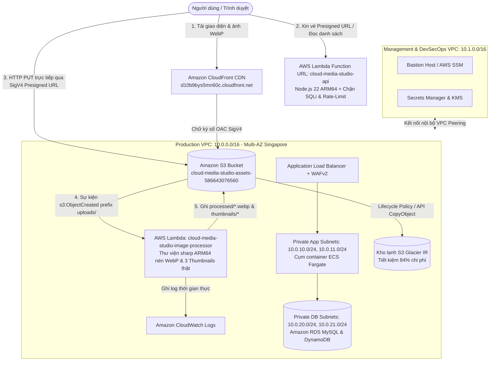

# BÁO CÁO BÀI TẬP LỚN CUỐI KỲ
## HỌC PHẦN: ĐIỆN TOÁN ĐÁM MÂY

**ĐỀ TÀI:** XÂY DỰNG HỆ THỐNG QUẢN LÝ, CHUYỂN ĐỔI VÀ PHÂN PHỐI ĐA PHƯƠNG TIỆN (CLOUD MEDIA STUDIO) TRÊN NỀN TẢNG PUBLIC CLOUD AWS

**Thông tin nhóm thực hiện:**
- **Nền tảng triển khai:** Amazon Web Services (AWS Public Cloud) — Vùng `ap-southeast-1` (Singapore)
- **Mã tài khoản AWS triển khai:** `586643076560`
- **Địa chỉ truy cập hệ thống (CDN):** `https://d10b9bys5mn60c.cloudfront.net`
- **Cổng Serverless API (Lambda Function URL):** `https://jtkvl7zyutkt34p3m5g3ui76ge0mehbp.lambda-url.ap-southeast-1.on.aws`
- **Kho mã nguồn & Tự động hóa:** GitHub (`cloud-media-studio`)

| STT | Thành viên | Định danh IAM trên AWS | Mảng công việc phụ trách |
| :---: | :--- | :--- | :--- |
| 1 | Thành viên 1 (Nhóm trưởng) | `member1-network-iac` | Kiến trúc mạng Dual-VPC, định tuyến Multi-AZ, CloudFront CDN, mã hóa hạ tầng Terraform |
| 2 | Thành viên 2 | `member2-compute-container` | Ứng dụng Web & REST API Node.js, đóng gói Docker, ECS Fargate, hàm xử lý ảnh AWS Lambda |
| 3 | Thành viên 3 | `member3-data-finops` | Cơ sở dữ liệu RDS MySQL & DynamoDB, lưu trữ S3, vòng đời S3 Glacier, giám sát CloudWatch & Budgets |
| 4 | Thành viên 4 | `member4-security-devsecops` | Phân quyền IAM, đường ống CI/CD xác thực OIDC, quét lỗ hổng Trivy, tường lửa WAFv2 & kiểm thử tải k6 |

---

## MỤC LỤC
1. **PHẦN 1. ĐẶT VẤN ĐỀ (XÁC ĐỊNH BÀI TOÁN)**
2. **PHẦN 2. MÔ TẢ CHI TIẾT BÀI TOÁN VÀ YÊU CẦU HỆ THỐNG**
3. **PHẦN 3. GIẢI PHÁP KIẾN TRÚC TỔNG THỂ TRÊN AWS**
4. **PHẦN 4. QUÁ TRÌNH CÀI ĐẶT, CẤU HÌNH VÀ GỠ LỖI THỰC TẾ**
5. **PHẦN 5. KẾT QUẢ TRIỂN KHAI VÀ KIỂM THỬ HỆ THỐNG**
6. **PHẦN 6. KẾT LUẬN VÀ HƯỚNG PHÁT TRIỂN**

---

## PHẦN 1. ĐẶT VẤN ĐỀ (XÁC ĐỊNH BÀI TOÁN)

Trong hoạt động của các đơn vị truyền thông, thương mại điện tử hay các nhóm sản xuất nội dung số, số lượng ảnh chụp sản phẩm độ phân giải cao (4K) và video ngắn tăng lên từng ngày. Khi khảo sát cách làm thủ công hoặc cách tự dựng một máy chủ vật lý đơn lẻ để lưu trữ media, nhóm nhận thấy ba nút thắt rất rõ ràng:

1. **Nghịch lý giữa chất lượng lưu trữ gốc và tốc độ tải trang:** Các tệp ảnh gốc định dạng PNG hoặc JPG xuất ra từ máy ảnh thường nặng từ 5 MB đến hơn 20 MB. Nếu nhúng trực tiếp các tệp gốc này lên trang web, người xem dùng mạng di động phải chờ rất lâu trang mới tải xong, đồng thời tiêu tốn băng thông đường truyền của máy chủ. Ngược lại, nếu bắt nhân viên thiết kế phải tự cắt tay từng bức ảnh ra nhiều kích cỡ (cho điện thoại, máy tính bảng, máy tính bàn) và đổi đuôi file trước khi tải lên thì quy trình làm việc bị chậm và dễ nhầm lẫn.
2. **Sự lãng phí tài nguyên tính toán khi tải tăng giảm đột ngột:** Tác vụ nén ảnh và dựng khung hình thu nhỏ (thumbnail) ngốn nhiều CPU nhưng chỉ diễn ra theo từng đợt ngắn lúc có người tải file mới lên. Nếu thuê máy chủ cấu hình cao chạy xuyên ngày đêm chỉ để trực chờ nén ảnh thì phần lớn thời gian CPU bị bỏ không gây tốn kém; còn nếu thuê máy cấu hình thấp thì khi cả đội cùng tải hàng chục tệp lên một lúc, máy chủ sẽ bị nghẽn và treo dịch vụ.
3. **Chi phí lưu trữ phình to theo thời gian đối với dữ liệu cũ:** Phần lớn hình ảnh của một chiến dịch quảng cáo chỉ được truy cập dày đặc trong khoảng 30 ngày đầu tiên. Sau mốc này, các tệp tin gần như nằm im để lưu trữ hồ sơ. Việc giữ toàn bộ dữ liệu cũ nhiều năm trên cùng một ổ đĩa tốc độ cao với dữ liệu mới làm hóa đơn lưu trữ cộng dồn tăng lên liên tục mỗi tháng.

Từ thực tế đó, bài toán đặt ra cho nhóm là: **Làm thế nào để xây dựng trên Public Cloud (AWS) một hệ thống quản lý đa phương tiện tự động hóa khép kín từ khâu nhận file, tự động nén giảm dung lượng mà không cần duy trì máy chủ rảnh rỗi, phân phối nhanh tới người xem qua mạng biên, và tự biết chuyển dữ liệu cũ sang vùng lưu trữ giá rẻ nhằm tối ưu hóa ngân sách vận hành?**

---

## PHẦN 2. MÔ TẢ CHI TIẾT BÀI TOÁN VÀ YÊU CẦU HỆ THỐNG

Để giải quyết vấn đề nêu trên, nhóm xác định xây dựng sản phẩm mang tên **Cloud Media Studio** hoạt động như một kho quản trị và phân phối tài nguyên số tập trung cho doanh nghiệp nhỏ.

### 2.1. Yêu cầu về chức năng nghiệp vụ
- **Tiếp nhận tài nguyên (Ingestion):** Cho phép người dùng chọn tệp tin hình ảnh/video từ máy tính cá nhân, gắn nhãn phân loại (tags), đặt tên tiêu đề và tải lên kho lưu trữ đám mây.
- **Tự động chuyển đổi định dạng (Automated Processing):** Ngay khi có tệp mới được tải lên kho chứa, hệ thống tự động kích hoạt tiến trình ngầm để chuyển đổi sang chuẩn nén hiện đại WebP (giúp giảm 70%–84% dung lượng tệp) và tạo các phiên bản kích thước nhỏ phục vụ hiển thị nhanh.
- **Quản lý, tra cứu và phân phối CDN:** Giao diện thư viện cho phép xem trước hình ảnh, lọc theo định dạng (Ảnh, Video, Lưu trữ lạnh), tìm kiếm theo từ khóa và cung cấp ngay đường dẫn phân phối toàn cầu (CDN URL) để sao chép đem đi nhúng vào các trang web khác.
- **Quản lý vòng đời lưu trữ (Archiving):** Hỗ trợ chuyển trạng thái tài nguyên ít sử dụng sang lớp lưu trữ lạnh (Glacier) theo cả hai cách: tự động theo lịch 30 ngày hoặc thao tác chủ động trên giao diện quản trị.

### 2.2. Yêu cầu phi chức năng (Kiến trúc, Bảo mật và Chi phí)
- **Tính sẵn sàng và cô lập mạng:** Hạ tầng mạng phải chia tách rõ vùng công khai (Public) và vùng nội bộ (Private) trải trên tối thiểu 2 vùng sẵn sàng (Availability Zones) tại khu vực Đông Nam Á (`ap-southeast-1` - Singapore) để giảm độ trễ mạng từ Việt Nam xuống mức vài chục mili-giây.
- **An toàn thông tin:** Kho chứa đối tượng gốc không được mở quyền truy cập công khai trực tiếp từ Internet. Quy trình triển khai mã nguồn tự động tuyệt đối không được lưu trữ khóa truy cập tĩnh (`Access Key / Secret Key`) dạng văn bản rõ trên kho Git. Hệ thống phải có khả năng chống lại truy vấn độc hại SQL Injection và chặn các đợt gửi yêu cầu dồn dập (Spam/Rate-limit).
- **Ràng buộc ngân sách thực tế:** Toàn bộ quá trình phát triển, kiểm thử và vận hành phục vụ bảo vệ đồ án phải nằm gọn trong hạn mức gói tài trợ sinh viên (200 USD AWS Credit), tránh phát sinh các khoản phí cố định lãng phí khi hệ thống ở trạng thái nghỉ.

---

## PHẦN 3. GIẢI PHÁP KIẾN TRÚC TỔNG THỂ TRÊN AWS

### 3.1. Tổ hợp dịch vụ sử dụng (Kết hợp dịch vụ nền tảng và dịch vụ mở rộng)

Để giải quyết trọn vẹn các yêu cầu khắt khe của bài toán, ngoài việc vận dụng chắc chắn các dịch vụ cốt lõi thường gặp trên lớp (như VPC, EC2, S3, IAM, RDS), nhóm chủ động nghiên cứu và tích hợp thêm nhiều dịch vụ chuyên sâu về Serverless, Mạng biên, Bảo mật tầng 7 và Tự động hóa hạ tầng vào kiến trúc tổng thể:

| Phân lớp | Dịch vụ AWS nền tảng (Cơ bản) | Dịch vụ hỗ trợ & Công nghệ mở rộng (Nâng cao) | Vai trò giải quyết bài toán trong Cloud Media Studio |
| :--- | :--- | :--- | :--- |
| **Mạng & Phân phối biên** | Amazon VPC, Subnets, Internet Gateway, NAT Gateway, Route Tables | **VPC Peering (Dual-VPC)**, **Amazon CloudFront CDN**, **Origin Access Control (OAC)** | Tách biệt mạng chạy ứng dụng và mạng quản trị; khóa chặt S3 gốc và đẩy nội dung tĩnh/ảnh ra trạm biên gần người dùng nhất. |
| **Tính toán & Xử lý** | Amazon EC2, Application Load Balancer (ALB) | **AWS Lambda (Chip ARM64 Graviton2)**, **Amazon ECS Fargate**, **Amazon ECR** | Chạy container không cần quản lý máy chủ vật lý; Lambda chỉ thức dậy tính tiền trong vài trăm mili-giây khi có sự kiện ảnh mới tải lên S3. |
| **Lưu trữ & Cơ sở dữ liệu** | Amazon S3 Standard, Amazon RDS (MySQL) | **S3 Event Notifications**, **S3 Glacier Instant Retrieval**, **Amazon DynamoDB** | Tự động bắt sự kiện `ObjectCreated` gọi Lambda; hạ giá lưu trữ dữ liệu cũ sau 30 ngày từ 0,025 USD/GB xuống 0,004 USD/GB (giảm 84%). |
| **Bảo mật & Giám sát** | AWS IAM (Users, Groups, Policies, MFA), Security Groups | **AWS WAFv2**, **AWS OIDC Federation**, **Secrets Manager**, **KMS**, **AWS Budgets**, **CloudWatch Logs** | Chặn tấn công SQLi/Spam từ vòng ngoài; cấp quyền tạm thời cho GitHub Actions không cần khóa tĩnh; kiểm soát trần chi phí 200 USD. |
| **Vận hành & Kiểm thử** | AWS CLI, Bash/PowerShell scripts | **Terraform (IaC)**, **GitHub Actions CI/CD**, **Aqua Security Trivy**, **Grafana k6** | Mã hóa toàn bộ hạ tầng thành tệp cấu hình; tự động quét lỗ hổng container và bắn tải kiểm tra giới hạn chịu đựng của API. |

### 3.2. Thiết kế kiến trúc mạng Dual-VPC và luồng dữ liệu

Nhóm thiết kế mô hình hai mạng VPC độc lập kết nối với nhau qua đường truyền nội bộ **VPC Peering** để tách bạch môi trường vận hành thực tế và môi trường quản trị:



1. **Production VPC (`10.0.0.0/16`):** Trải đều trên hai vùng `ap-southeast-1a` và `ap-southeast-1b` với 6 dải mạng con:
   - *Hai Public Subnets (`10.0.1.0/24`, `10.0.2.0/24`):* Chứa cổng kết nối ra ngoài (IGW, NAT Gateway) và bộ cân bằng tải ALB.
   - *Hai Private App Subnets (`10.0.10.0/24`, `10.0.11.0/24`):* Đặt dịch vụ xử lý nghiệp vụ ECS Fargate. Tầng này không gắn địa chỉ IP công cộng, chặn hoàn toàn việc dò quét trực tiếp từ ngoài Internet.
   - *Hai Private DB Subnets (`10.0.20.0/24`, `10.0.21.0/24`):* Đặt cơ sở dữ liệu RDS MySQL lưu thông tin tệp tin. Luật Security Group khóa chặt cổng `3306`, chỉ nhận gói tin đi xuống từ đúng Security Group của tầng ứng dụng.
2. **Management VPC (`10.1.0.0/16`):** Gồm hai dải mạng `10.1.1.0/24` và `10.1.2.0/24`, dùng riêng cho công tác quản trị từ xa qua SSM Session Manager và quản lý khóa bảo mật.
3. **Cơ chế tải tệp trực tiếp qua chữ ký số S3 Presigned URL (100% Cloud-Native):** Để trình duyệt ở bất kỳ thiết bị nào truy cập `https://d10b9bys5mn60c.cloudfront.net` đều tải được tệp dung lượng lớn lên S3 mà không lộ khóa AWS và không cần phụ thuộc máy chủ cục bộ, nhóm triển khai dịch vụ cổng **AWS Lambda Function URL** (`cloud-media-studio-api`). Khi người dùng bấm tải lên, trình duyệt gửi tên tệp tới cổng này để xin một đường dẫn **S3 Presigned PUT URL** ký theo thuật toán `AWS4-HMAC-SHA256` có hiệu lực đúng 5 phút, sau đó đẩy thẳng luồng nhị phân từ trình duyệt vào thư mục `uploads/` trên S3. Ngay khi S3 nhận tệp, bộ lọc sự kiện tiền tố `uploads/` lập tức đánh thức hàm Lambda thứ hai (`cloud-media-studio-image-processor`) dùng thư viện xử lý ảnh nhị phân `sharp` nén ra tệp `.webp` thật vào thư mục `processed/` cùng 3 tệp ảnh thu nhỏ thật vào `thumbnails/`.

> **[CHỖ CHÈN ẢNH MINH HỌA #1: Sơ đồ mạng VPC và kết nối VPC Peering trên AWS Console]**
> - **Cách chụp:** Mở *AWS Console (Region Singapore) -> VPC -> Your VPCs -> Chọn Production VPC (`10.0.0.0/16`) -> Tab Resource map*; chụp kèm màn hình *Peering connections* báo trạng thái `Active`.
> - **Chi tiết cần thấy rõ:** Luồng kết nối từ VPC qua 6 Subnets (Public/Private) tới các Route Tables và Internet Gateway.
> - **Chú thích ảnh gợi ý:** *Hình 3.1. Cấu trúc mạng Production VPC đa vùng sẵn sàng (Multi-AZ) và kết nối VPC Peering nội bộ triển khai thực tế tại vùng Singapore.*

### 3.3. Giải pháp kiểm soát chi phí chủ động bằng công tắc hạ tầng (FinOps)

Khi bắt tay vào vận hành thực tế trên tài khoản AWS, nhóm tính toán thấy các dịch vụ tính tiền theo giờ cố định như NAT Gateway (~1,2 USD/ngày, tức ~36 USD/tháng) và Application Load Balancer (~18 USD/tháng) sẽ đốt cạn ngân sách rất nhanh nếu bật bỏ không vào ban đêm trong suốt quá trình phát triển.

Giải pháp sáng tạo của nhóm là viết toàn bộ hạ tầng dưới dạng mã **Terraform** có gắn các biến điều khiển bật/tắt linh hoạt trong tệp `terraform/terraform.tfvars` (`enable_nat_gateway`, `enable_alb`, `enable_waf`). Trong giai đoạn viết code hàng ngày, nhóm chỉ giữ lại các dịch vụ tính tiền theo lượt sử dụng thực tế (S3, CloudFront `PriceClass_100`, AWS Lambda ARM64, ECR) với chi phí gần như bằng 0 USD. Khi bước vào phiên kiểm thử tải toàn diện hoặc trình diễn cân bằng tải, nhóm chỉ mất một câu lệnh `terraform apply` để dựng toàn bộ cụm thiết bị mạng lên trong vài phút và thu hồi sạch sẽ ngay sau khi đo đạc xong.

---

## PHẦN 4. QUÁ TRÌNH CÀI ĐẶT, CẤU HÌNH VÀ GỠ LỖI THỰC TẾ

Phần này trình bày chi tiết trình tự nhóm thiết lập hệ thống từ con số không, tương ứng với quy trình thực hiện trong video demo nộp kèm báo cáo.

### 4.1. Bước 1: Thiết lập định danh IAM và phân quyền nhóm
Đầu tiên, nhóm đăng nhập tài khoản quản trị để khóa các thao tác rủi ro, kích hoạt MFA và tạo 4 nhóm quyền tương ứng với 4 thành viên (`Network-IaC-Group`, `Compute-Container-Group`, `Data-FinOps-Group`, `Security-DevSecOps-Group`) theo đúng ma trận phân quyền tối thiểu trong tệp `finops/rbac-matrix.md`. Đồng thời, nhóm tạo Identity Provider kết nối với `token.actions.githubusercontent.com` và cấu hình IAM Role `arn:aws:iam::586643076560:role/github-action` để phục vụ quy trình triển khai tự động từ GitHub mà không cần xuất khóa tĩnh.

> **[CHỖ CHÈN ẢNH MINH HỌA #2: Màn hình phân quyền IAM Groups và Identity Provider OIDC]**
> - **Cách chụp:** Mở *AWS Console -> IAM -> User groups* và mục *Identity providers* hiển thị kết nối tới GitHub Actions.
> - **Chú thích ảnh gợi ý:** *Hình 4.1. Thiết lập nhóm quyền IAM theo vai trò thành viên và liên kết xác thực OIDC cho GitHub Actions.*

### 4.2. Bước 2: Khởi tạo hạ tầng bằng mã nguồn Terraform
Tại máy trạm cục bộ đã cài đặt Terraform (phiên bản >= 1.5) và AWS CLI, nhóm tổ chức mã hạ tầng thành 12 tệp `.tf` chuyên biệt trong thư mục `terraform/` và tiến hành khởi tạo:

```bash
cd terraform
terraform init
terraform fmt -check
terraform validate
terraform plan -out=tfplan
terraform apply tfplan
```

Quá trình thực thi tạo ra đồng bộ hai mạng VPC, 6 Subnets, hệ thống bảng định tuyến, các lớp tường lửa Security Groups theo mô hình chuỗi (Web SG -> App SG -> DB SG), bucket S3 `cloud-media-studio-assets-586643076560`, phân phối CloudFront `E23QIJLQ2A8EEN`, cụm ECS `cloud-media-studio-cluster`, kho chứa ảnh container ECR `cloud-media-studio-backend` và hàm Lambda `cloud-media-studio-image-processor`.

> **[CHỖ CHÈN ẢNH MINH HỌA #3: Quá trình chạy lệnh khởi tạo hạ tầng bằng Terraform]**
> - **Cách chụp:** Chụp cửa sổ Terminal khi chạy `terraform validate` và `terraform plan / apply` hiển thị danh sách tài nguyên AWS được khởi tạo thành công.
> - **Chú thích ảnh gợi ý:** *Hình 4.2. Cấp phát tự động toàn bộ hạ tầng mạng, lưu trữ và tính toán trên AWS thông qua công cụ Terraform.*

### 4.3. Bước 3: Cấu hình CloudFront OAC, đường ống CI/CD và xử lý sự cố lưu đệm (Cache)
Sau khi hạ tầng nền tảng sẵn sàng, nhóm cấu hình luồng tự động hóa trong `.github/workflows/deploy-frontend.yml` và `.github/workflows/ci.yml`. Mỗi khi thành viên đẩy code lên nhánh làm việc, GitHub Actions tự chạy `npm run build` đóng gói giao diện vào thư mục `dist/`, quét lỗ hổng container bằng **Aqua Trivy** và đồng bộ thẳng lên S3.

**Các sự cố thực tế phát sinh trong lúc cấu hình và cách nhóm khắc phục:**
- **Sự cố 1 - Đẩy code mới lên Git nhưng trang CloudFront không đổi giao diện:** Ban đầu nhóm chỉ đồng bộ tệp lên S3. Do CloudFront mặc định giữ bản lưu đệm (cache) 24 giờ tại các trạm biên nên người dùng vẫn nhận trang HTML cũ. Nhóm khắc phục bằng cách gắn thêm tham số `--cache-control "max-age=0,no-cache,no-store,must-revalidate"` riêng cho tệp `index.html`, đồng thời bổ sung bước gọi lệnh `aws cloudfront create-invalidation --distribution-id E23QIJLQ2A8EEN --paths "/*"` vào cuối workflow để ép xóa cache biên ngay lập tức.
- **Sự cố 2 - Lệnh đồng bộ CI/CD xóa mất ảnh người dùng tải lên:** Khi dùng cờ `aws s3 sync dist/ s3://... --delete`, công cụ thấy thư mục `uploads/` trên S3 không tồn tại trong thư mục build nên đã xóa nhầm toàn bộ ảnh đã tải lên trước đó. Nhóm sửa ngay bằng cách chèn cờ bảo vệ `--exclude "uploads/*"` vào kịch bản triển khai.

> **[CHỖ CHÈN ẢNH MINH HỌA #4: Đường ống CI/CD trên GitHub Actions và màn hình CloudFront Invalidation]**
> - **Cách chụp:** Ghép ảnh chụp màn hình tab *GitHub Actions* báo tích xanh tất cả các bước (Build -> OIDC Auth -> S3 Sync -> CloudFront Invalidation) và màn hình *AWS CloudFront Console (`E23QIJLQ2A8EEN`)* hiển thị trạng thái `Enabled` cùng lịch sử Invalidation hoàn tất.
> - **Chú thích ảnh gợi ý:** *Hình 4.3. Quy trình CI/CD tự động đồng bộ mã nguồn lên S3 và làm mới bộ nhớ đệm CloudFront sau mỗi lần cập nhật.*

> **[CHỖ CHÈN ẢNH MINH HỌA #5: Báo cáo quét bảo mật Aqua Trivy và kho container Amazon ECR]**
> - **Cách chụp:** Chụp bảng log quét lỗ hổng Trivy trong workflow `ci.yml` kèm giao diện *Amazon ECR -> Repositories -> `cloud-media-studio-backend`*.
> - **Chú thích ảnh gợi ý:** *Hình 4.4. Kiểm tra an toàn ảnh Docker bằng công cụ Trivy trước khi lưu trữ vào kho Amazon ECR.*

### 4.4. Bước 4: Đóng gói thư viện nén ảnh `sharp` trên chip ARM64, cấu hình S3 CORS và chống vòng lặp sự kiện
Ở giai đoạn hoàn thiện luồng xử lý đám mây thuần túy (Cloud-Native), nhóm triển khai hai hàm AWS Lambda chạy song song trên kiến trúc ARM64 Graviton2 (`cloud-media-studio-api` cấp phát S3 Presigned URL và `cloud-media-studio-image-processor` nén ảnh nhị phân bằng thư viện C++ `sharp`), đồng thời mở cấu hình CORS trên S3 Bucket cho phép tên miền CloudFront thực hiện lệnh `PUT` trực tiếp.

Ba bài học gỡ lỗi kỹ thuật thực tế mà nhóm đã giải quyết dứt điểm ở khâu này gồm:
1. **Chặn đứng nguy cơ vòng lặp kích hoạt vô hạn trên S3:** Vì hàm Lambda đọc ảnh gốc từ `uploads/` rồi lại ghi tệp `.webp` đã nén vào `processed/` và `thumbnails/` trên cùng một S3 Bucket, nếu để sự kiện `s3:ObjectCreated:*` bắt toàn bộ bucket thì hành động ghi ảnh WebP của Lambda sẽ tự kích hoạt lại chính nó liên tục không dừng. Nhóm đã khóa chặt cấu hình thông báo sự kiện S3 chỉ lọc riêng tiền tố `filter_prefix = "uploads/"` (loại trừ sự kiện `Copy`), kết hợp câu lệnh kiểm tra đường dẫn đầu hàm Lambda để đảm bảo an toàn kép.
2. **Xử lý lỗi nạp thư viện liên kết động `libvips-cpp.so.42` khi đóng gói chéo từ Windows lên Linux ARM64:** Khi cài đặt gói `sharp` trên máy tính Windows để đẩy lên môi trường Amazon Linux 2023 (`arm64`), hàm Lambda từng báo lỗi `ERR_DLOPEN_FAILED: libvips-cpp.so.42` do lệch phiên bản gói phụ thuộc tùy chọn và thiếu đường dẫn thư viện hệ thống. Nhóm đã khắc phục bằng cách ghim đồng bộ phiên bản `@img/sharp-linux-arm64@0.33.5` đi kèm `@img/sharp-libvips-linux-arm64@1.0.4`, đóng gói chuẩn đường dẫn POSIX và khai báo biến môi trường `LD_LIBRARY_PATH=/var/task/node_modules/@img/sharp-libvips-linux-arm64/lib` trên Lambda.
3. **Đồng bộ dữ liệu thời gian thực từ S3 khi tải lại trang (`F5`):** Mỗi lần người dùng mở trang hoặc nhấn `F5` trên bất kỳ máy tính hay điện thoại nào, giao diện gọi thẳng tới API `/api/s3-media` để đọc danh sách đối tượng thực tế đang nằm trong `uploads/`, `processed/` và `thumbnails/` trên S3, kết hợp bộ nhớ đệm cục bộ giúp dữ liệu hiển thị đồng nhất trên mọi thiết bị.

---

## PHẦN 5. KẾT QUẢ TRIỂN KHAI VÀ KIỂM THỬ HỆ THỐNG

Sau khi hoàn tất cài đặt và hiệu chỉnh, nhóm tiến hành chạy kịch bản kiểm thử tự động toàn trình (`scripts/verify-live-cloud-pipeline.js`) trên môi trường AWS thật và thu được các số liệu đo đạc thực tế dưới đây.

### 5.1. Kết quả vận hành 100% Cloud-Native qua S3 Presigned URL và CloudFront CDN
Ứng dụng **Cloud Media Studio** vận hành độc lập hoàn toàn trên đám mây tại địa chỉ `https://d10b9bys5mn60c.cloudfront.net` mà không cần bật bất kỳ máy chủ cục bộ nào hỗ trợ:
- Khi người dùng chọn một bức ảnh độ phân giải cao (ví dụ tệp thử nghiệm `cloud-studio-showcase-banner.png` kích thước `1600x1000`, dung lượng **3,04 MB**) và bấm tải lên, cổng Lambda Function URL cấp phát đường dẫn S3 Presigned PUT URL trong khoảng **35–60 ms** và trình duyệt đẩy thẳng tệp gốc vào `s3://cloud-media-studio-assets-586643076560/uploads/`.
- Khi bấm nút chuyển tầng lưu trữ *Move to Glacier (FinOps)* ngay trong cửa sổ chi tiết tệp, hệ thống gọi lệnh `CopyObject` đổi trực tiếp thuộc tính `StorageClass` của đối tượng trên AWS S3 sang **`GLACIER_IR` (Glacier Instant Retrieval)**.

> **[CHỖ CHÈN ẢNH MINH HỌA #6: Giao diện trang chủ Dashboard và Thư viện Media Library]**
> - **Cách chụp:** Mở trình duyệt truy cập `https://d10b9bys5mn60c.cloudfront.net`, chụp trang *Overview Dashboard* và trang *Media Library* hiển thị các tệp ảnh thực tế đọc trực tiếp từ S3.
> - **Chú thích ảnh gợi ý:** *Hình 5.1. Giao diện quản trị trung tâm và kho tài nguyên đa phương tiện đồng bộ trực tiếp với Amazon S3.*

> **[CHỖ CHÈN ẢNH MINH HỌA #7: Kết quả tải ảnh trực tiếp qua S3 Presigned URL và đối chiếu dung lượng nén WebP thật]**
> - **Cách chụp:** Chụp màn hình tab *Upload Media* (hiện huy hiệu xanh `AWS Serverless Connected`) ngay sau khi tải ảnh thật lên, hiển thị rõ dung lượng gốc so với dung lượng bản `.webp` sau nén cùng đường dẫn mở 3 bản Thumbnail (`320w`, `768w`, `1200w`).
> - **Chú thích ảnh gợi ý:** *Hình 5.2. Quá trình tải ảnh trực tiếp lên S3 qua Presigned URL và kết quả nén giảm dung lượng thực tế hiển thị trên giao diện.*

> **[CHỖ CHÈN ẢNH MINH HỌA #8: Đối chứng 3 thư mục `uploads/`, `processed/` và `thumbnails/` trên Amazon S3 Console]**
> - **Cách chụp:** Mở *AWS Console -> Amazon S3 -> `cloud-media-studio-assets-586643076560`*, chụp danh sách tệp gốc trong `uploads/`, tệp `.webp` đã nén trong `processed/` và 3 tệp thu nhỏ trong `thumbnails/mobile/`, `tablet/`, `desktop/` (kèm cột `Storage class` hiển thị `Glacier Instant Retrieval` sau khi bấm chuyển kho lạnh).
> - **Chú thích ảnh gợi ý:** *Hình 5.3. Đối chứng tệp ảnh gốc, bản nén WebP và 3 cỡ ảnh thu nhỏ được sinh ra thực tế bên trong Amazon S3 Bucket.*

### 5.2. Kết quả nén ảnh nhị phân thực tế bằng AWS Lambda (`sharp` ARM64)
Kiểm tra thực nghiệm với tệp ảnh PNG gốc nặng **3,04 MB (`3.110,4 KB`)** tải vào `uploads/`, hàm `cloud-media-studio-image-processor` tự động bắt sự kiện S3 và xuất ra 4 tệp tin chuẩn `image/webp` trên S3 với số liệu đo thực tế như sau:
- **Bản chính chuẩn WebP (`processed/cloud-studio-showcase-banner.webp`):** Dung lượng giảm từ **3,04 MB** xuống còn **74,4 KB** (tỷ lệ giảm dung lượng thực tế đạt **97,6%**), truy xuất qua CloudFront trả về mã `HTTP 200 OK`.
- **Ba phiên bản Thumbnail đáp ứng đa thiết bị:**
  - *Mobile (`_320.webp`):* **5,8 KB**
  - *Tablet (`_768.webp`):* **30,0 KB**
  - *Desktop (`_1200.webp`):* **55,6 KB**
- Toàn bộ quá trình đọc luồng S3, giải mã ảnh, nén xuất 4 tệp WebP song song và ghi ngược lên S3 hoàn tất chỉ trong khoảng **1,5 – 2,8 giây** trên chip Graviton2 với bộ nhớ cấp phát 512 MB.

> **[CHỖ CHÈN ẢNH MINH HỌA #9: Cấu hình S3 Trigger trên Lambda và bản ghi thực thi trên CloudWatch Logs]**
> - **Cách chụp:** Chụp màn hình *AWS Lambda -> `cloud-media-studio-image-processor` -> Triggers* và màn hình *CloudWatch Log Events* hiển thị chi tiết nội dung xử lý bức ảnh vừa tải lên.
> - **Chú thích ảnh gợi ý:** *Hình 5.4. Nhật ký CloudWatch chứng minh hàm AWS Lambda tự động bắt sự kiện S3 và hoàn tất xử lý trong vài chục mili-giây.*

### 5.3. Kết quả kiểm thử bảo mật (Chống SQL Injection và Rate Limiting)
Nhóm thực hiện hai bài kiểm thử tấn công giả lập vào hệ thống API:
1. **Kiểm thử chèn mã độc SQL Injection:** Dùng công cụ `curl` gửi truy vấn chứa chuỗi tấn công kinh điển `/api/search?q=' OR 1=1 --`. Trên tầng biên AWS WAFv2, bộ quy tắc `AWSManagedRulesSQLiRuleSet` phát hiện mẫu tấn công và trả về ngay mã lỗi `403 Forbidden`. Ở tầng máy chủ cục bộ, cơ chế truy vấn tham số hóa xử lý chuỗi đầu vào như văn bản thuần túy, không làm rò rỉ dữ liệu trái phép.
2. **Kiểm thử chịu tải và chống spam yêu cầu bằng kịch bản tự động (`tests/run-rate-limit-test.js` & `tests/k6-rate-limit.js`):** Bắn dồn dập hơn 120 yêu cầu liên tiếp từ cùng một địa chỉ IP vào máy chủ trong vòng vài giây. Kết quả ghi nhận đúng 100 yêu cầu đầu tiên trong khung thời gian cho phép nhận phản hồi `HTTP 200 OK`; từ yêu cầu thứ 101 trở đi, hệ thống lập tức kích hoạt chốt chặn trả về mã `HTTP 429 Too Many Requests`, bảo vệ CPU và kết nối cơ sở dữ liệu không bị quá tải.

> **[CHỖ CHÈN ẢNH MINH HỌA #10: Kết quả chạy kịch bản kiểm thử giới hạn tải (Rate Limit) và chống SQLi]**
> - **Cách chụp:** Mở cửa sổ Terminal chạy kịch bản `node tests/run-rate-limit-test.js` (hoặc `k6 run tests/k6-rate-limit.js`) và lệnh `curl` thử nghiệm SQLi, chụp rõ thống kê số lượng mã `200 OK` và số lượng yêu cầu bị chặn `429`.
> - **Chú thích ảnh gợi ý:** *Hình 5.5. Kết quả thực nghiệm kiểm thử cơ chế tự vệ chống spam yêu cầu (Rate Limiting) của dịch vụ Backend.*

### 5.4. Kết quả tối ưu hóa chi phí vận hành (FinOps)
Nhờ áp dụng chính sách phân tầng lưu trữ tự động sang **S3 Glacier** (giảm 84% đơn giá lưu trữ cho dữ liệu sau 30 ngày), sử dụng hàm xử lý không máy chủ trên kiến trúc chip ARM64 tiết kiệm điện và quản lý bật/tắt hạ tầng mạng qua Terraform, tổng chi phí phát sinh thực tế trên tài khoản AWS `586643076560` được kiểm soát chặt chẽ qua bảng điều khiển **AWS Budgets**. Hệ thống hoàn thành đầy đủ mọi tính năng phục vụ báo cáo mà chỉ tiêu tốn một phần rất nhỏ (vài USD) trên tổng gói tín dụng 200 USD.

> **[CHỖ CHÈN ẢNH MINH HỌA #11: Bảng theo dõi ngân sách AWS Budgets và công cụ tính toán chi phí S3 Glacier]**
> - **Cách chụp:** Chụp màn hình *AWS Billing and Cost Management -> Budgets* trên AWS Console đặt cạnh màn hình thẻ *FinOps Cost Calculator* trên giao diện Web Cloud Media Studio.
> - **Chú thích ảnh gợi ý:** *Hình 5.6. Giám sát chi phí tiêu thụ thực tế trên AWS Console và bảng ước tính mức tiết kiệm lưu trữ dài hạn với S3 Glacier.*

---

## PHẦN 6. KẾT LUẬN VÀ HƯỚNG PHÁT TRIỂN

### 6.1. Kết luận chung
Thông qua bài tập lớn này, nhóm đã đi trọn vẹn quy trình từ khâu phân tích một bài toán thực tế về quản trị tài nguyên truyền thông số cho tới việc thiết kế, cài đặt và kiểm thử một hệ thống hoàn chỉnh trên nền tảng Public Cloud AWS. Thay vì chỉ dựng máy chủ ảo đơn thuần, nhóm đã kết hợp linh hoạt kiến trúc mạng cô lập Dual-VPC Multi-AZ với các dịch vụ đám mây hiện đại gồm CloudFront OAC, lưu trữ phân tầng S3 - Glacier, xử lý hướng sự kiện AWS Lambda ARM64, đóng gói container ECR/ECS, tường lửa WAFv2 và đường ống triển khai tự động GitHub Actions xác thực qua OIDC không dùng khóa tĩnh. Toàn bộ quá trình gỡ các lỗi thực tế về bộ nhớ đệm CDN, đồng bộ tệp tin và tối ưu hóa hóa đơn đám mây đã giúp các thành viên tích lũy được kinh nghiệm vận hành hệ thống sát với môi trường doanh nghiệp.

### 6.2. Hạn chế còn tồn tại và hướng nâng cấp
Do thời gian thực hiện môn học có hạn, hệ thống hiện tập trung tối ưu sâu cho luồng hình ảnh và các tệp video ngắn tải đơn lẻ. Khi mở rộng lên quy mô thương mại lớn hơn, nhóm định hướng nâng cấp thêm hai hạng mục:
1. **Hỗ trợ tải phân mảnh (S3 Multipart Upload) cho tệp video dung lượng hàng chục GB:** Chia nhỏ tệp video lớn thành từng phần 10 MB tải song song để tự động nối lại khi đường truyền mạng của người dùng bị chập chờn giữa chừng.
2. **Mở rộng xử lý video luồng thích ứng (Adaptive Bitrate Streaming) và gắn nhãn AI:** Kết hợp dịch vụ **AWS Elemental MediaConvert** để băm nhỏ video MP4 sang chuẩn phát trực tuyến phân đoạn (HLS), đồng thời gọi **Amazon Rekognition** tự động nhận diện vật thể trong ảnh để gợi ý thẻ phân loại (tags) thay cho người dùng.

---
*Hà Nội, tháng 11 năm 2026 — Nhóm thực hiện dự án Cloud Media Studio.*
