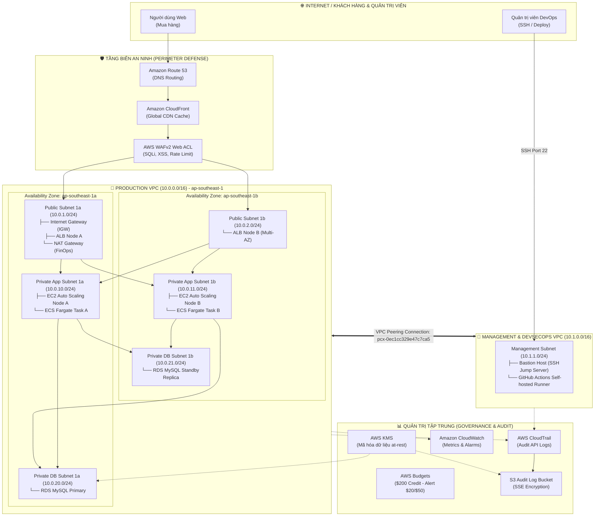

# THIẾT KẾ KIẾN TRÚC AWS ENTERPRISE LANDING ZONE
## DỰ ÁN: ENTERPRISE CLOUD & DEVSECOPS PLATFORM
**Tác giả:** Thành viên 1 (Nhóm trưởng — Mạng & IaC)

---

## 1. TỔNG QUAN VỀ AWS LANDING ZONE

### 1.1. Khái niệm Landing Zone trong Doanh nghiệp
**AWS Landing Zone** là một khung nền tảng đám mây đạt chuẩn **AWS Well-Architected Framework**, cung cấp một môi trường đa tài khoản (Multi-Account) hoặc đa đám mây riêng ảo (Multi-VPC) được cấu hình sẵn các quy chuẩn về:
- **Phân tách môi trường an toàn (Security & Isolation)**.
- **Quản trị danh tính & đặc quyền tối thiểu (Identity & Access Management)**.
- **Mạng trung tâm kết nối an toàn (Centralized Networking)**.
- **Thu thập và lưu trữ nhật ký kiểm toán tập trung (Centralized Logging & Audit)**.
- **Kiểm soát ngân sách tài chính (FinOps Governance)**.

### 1.2. Chiến lược triển khai Landing Zone của Nhóm
Do đặc thù môi trường học thuật sử dụng gói tài trợ sinh viên $200 AWS Credit (vận hành trên 1 AWS Account chính), nhóm áp dụng mô hình **Enterprise Multi-VPC Landing Zone Baseline** được tự động hóa 100% bằng Terraform:
- **Tách biệt ranh giới mạng (Network Boundary)**: Cô lập hoàn toàn giữa môi trường **Production (Ứng dụng bán hàng)** và **Management / DevSecOps (Công cụ quản trị)** thông qua mô hình Dual-VPC.
- **Định tuyến an toàn qua VPC Peering**: Kết nối hai chiều được mã hóa hoàn toàn trên hạ tầng trục (Backbone) của AWS mà không để lộ lưu lượng ra Internet công cộng.
- **Vòng đai bảo vệ rìa mạng (Perimeter Defense)**: Tích hợp AWS WAFv2, CloudFront CDN và Application Load Balancer làm cổng kiểm soát duy nhất.

---

## 2. SƠ ĐỒ KIẾN TRÚC TỔNG THỂ (LANDING ZONE BLUEPRINT)

---

## 3. CÁC THÀNH PHẦN CỐT LÕI CỦA LANDING ZONE

### 3.1. Ranh giới Mạng Đa tầng (Network Segmentation & Isolation)
Landing Zone được phân hoạch thành **2 VPC** độc lập với cấu trúc Subnet 3 tầng nghiêm ngặt:

| Tầng mạng (Tier) | Tên Subnet | Dải CIDR | Loại kết nối Internet | Tài nguyên triển khai |
| :--- | :--- | :--- | :---: | :--- |
| **Edge Public** | `public-1a`, `public-1b` | `10.0.1.0/24`, `10.0.2.0/24` | 2 chiều qua IGW | ALB, NAT Gateway, CloudFront Ingress |
| **Compute Private** | `private-app-1a`, `private-app-1b` | `10.0.10.0/24`, `10.0.11.0/24` | 1 chiều ra (Egress-only qua NAT GW) | EC2 ASG, ECS Fargate, EFS Mount Target |
| **Database Isolated**| `private-db-1a`, `private-db-1b` | `10.0.20.0/24`, `10.0.21.0/24` | **Cách ly 100% (Không Internet)** | RDS MySQL Multi-AZ, DynamoDB Endpoint |
| **Management** | `mgmt-subnet-1a`, `mgmt-subnet-1b` | `10.1.1.0/24`, `10.1.2.0/24` | Qua Bastion Host / Peering | Bastion Host, DevOps Management |

### 3.2. Đường hầm liên kết an toàn (VPC Peering Transit)
- **Mã kết nối**: `pcx-0ec1cc329e47c7ca5`
- **Mục đích**: Cho phép các kỹ sư DevOps từ `Management VPC` SSH hoặc gửi lệnh kiểm toán sang máy chủ ứng dụng trong `Production VPC` mà không phải mở cổng SSH (Port 22) ra ngoài Internet.
- **Bảo mật**: Tuyệt đối chặn mọi luồng traffic từ Internet đi vào Management VPC.

### 3.3. Vành đai bảo vệ An ninh đa lớp (Security Guardrails)
Landing Zone tích hợp 4 lớp bảo vệ tự động (Guardrails):
1. **Lớp 1 — Tường lửa biên (AWS WAFv2)**: Chặn đứng mã độc SQLi (`' OR 1=1 --`), XSS và giới hạn tần suất 100 req/5m.
2. **Lớp 2 — Tường lửa ảo (Security Group Chaining)**:
   - Database SG chỉ nhận cổng 3306 từ App SG (không mở theo IP).
   - App SG chỉ nhận cổng 3000 từ ALB SG.
   - ALB SG chỉ nhận cổng 80/443 từ Internet.
3. **Lớp 3 — Mã hóa dữ liệu (Encryption Everywhere)**:
   - Dữ liệu tĩnh trên S3 mã hóa bằng AES-256 (SSE-S3 / SSE-KMS).
   - Cơ sở dữ liệu RDS MySQL mã hóa ổ đĩa lưu trữ bằng AWS KMS.
   - Kết nối giữa người dùng và ALB qua HTTPS/TLS.
4. **Lớp 4 — Xác thực Zero-Trust & Zero Secret Keys**:
   - Sử dụng **GitHub OIDC Role** cho đường ống CI/CD, không lưu trữ AWS Access Key / Secret Key trong mã nguồn.

### 3.4. Quản trị Tài chính & Vận hành (FinOps & Observability Baseline)
- **AWS Budgets**: Thiết lập chính sách kiểm soát gói tài trợ $200 với 2 ngưỡng cảnh báo email tự động ($20 và $50).
- **Công tắc FinOps**: Bật/tắt linh hoạt NAT Gateway (`enable_nat_gateway = false/true`) và ALB (`enable_alb_and_waf = false/true`) giúp tiết kiệm tối đa chi phí chạy nền.
- **CloudTrail & CloudWatch**: Ghi vết 100% hoạt động thay đổi hạ tầng và phát cảnh báo khi CPU máy chủ vượt ngưỡng 70%.

---

## 4. ÁNH XẠ LANDING ZONE VÀO MÃ NGUỒN TERRAFORM HIỆN TẠI

Toàn bộ Landing Zone trên đã được mã hóa 100% trong thư mục `terraform/` của dự án:

| Thành phần Landing Zone | Tệp Terraform tương ứng | Trạng thái triển khai |
| :--- | :--- | :---: |
| **Production VPC & Subnets Multi-AZ** | `vpc.tf`, `subnets.tf`, `routes.tf`, `gateways.tf` | ✅ Đã hoàn thành |
| **Management VPC & Peering** | `vpc_peering.tf` | ✅ Đã hoàn thành |
| **Tường lửa Security Groups Matrix** | `security_groups.tf` | ✅ Đã hoàn thành |
| **Cân bằng tải & Tường lửa WAF** | `alb.tf`, `waf.tf` | ✅ Đã hoàn thành |
| **Phân phối CDN & DNS** | `cloudfront.tf`, `route53.tf` | ✅ Đã hoàn thành |
| **Kịch bản tự động hóa 1-Click** | `scripts/deploy.ps1`, `scripts/destroy.ps1` | ✅ Đã hoàn thành |
| **Quản trị Ngân sách FinOps & Log** | `finops/terraform/budgets.tf`, `cloudtrail.tf` | ✅ Đã hoàn thành |

---

## 5. KẾT LUẬN & GIÁ TRỊ DOANH NGHIỆP
Kiến trúc **AWS Enterprise Landing Zone** của nhóm cung cấp một nền móng hạ tầng vững chắc, có khả năng mở rộng (Scalable), bảo mật đa tầng (Secure by Design) và tự động hóa tuyệt đối. Đây là bằng chứng rõ ràng nhất chứng minh năng lực thiết kế hạ tầng đám mây chuẩn doanh nghiệp của cả nhóm trước Hội đồng chấm thi.
