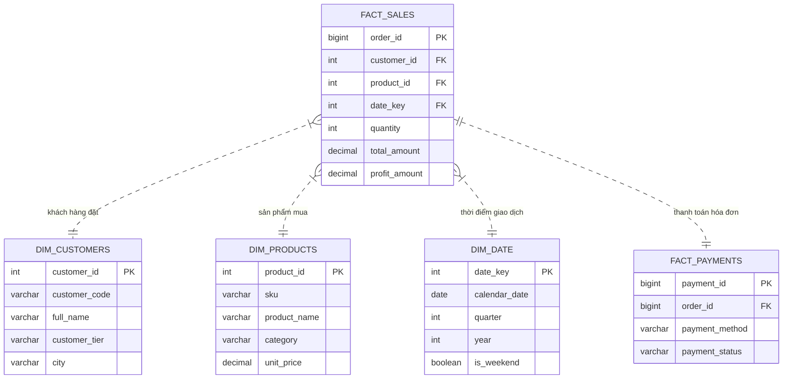

# BÁO CÁO TỐI ƯU CHI PHÍ & DỌN DẸP AMAZON REDSHIFT SERVERLESS (TUẦN 5)

> **Dự án:** Enterprise Cloud DevSecOps Platform  
> **Thành viên thực hiện:** Thành viên 3 — Dữ liệu & FinOps (Phạm Thế Hùng)  
> **Gói tài trợ Cloud:** AWS Educate / Student Credits ($200 USD)  
> **Thời gian thực hiện:** Tuần 5 — Phân tích dữ liệu nâng cao & Vận hành FinOps  
> **Trạng thái cụm Redshift:** 🟢 **ĐÃ DỌN DẸP HOÀN TOÀN (100% DELETED / DESTROYED)**

---

## 1. BỐI CẢNH VÀ THÁCH THỨC FINOPS (THE FINOPS DILEMMA)

Trong kiến trúc Enterprise Cloud DevSecOps đa tầng, nhu cầu phân tích dữ liệu kinh doanh (Business Intelligence & Data Warehousing) từ cơ sở dữ liệu giao dịch (RDS MySQL) đòi hỏi một nền tảng kho dữ liệu có năng lực xử lý phân tích song song (MPP - Massively Parallel Processing).

Tuy nhiên, **Amazon Redshift** là một trong những dịch vụ tốn kém nhất trên AWS nếu không được kiểm soát chặt chẽ:

```
┌────────────────────────────────────────────────────────────────────────┐
│                   SO SÁNH MÔ HÌNH VẬN HÀNH REDSHIFT                    │
├──────────────────────────────────┬─────────────────────────────────────┤
│ ❌ Cụm truyền thống (Provisioned)│ 🟢 Serverless Ephemeral (Demo 1-2h) │
├──────────────────────────────────┼─────────────────────────────────────┤
│ • Chạy 24/7 cả tháng             │ • Chỉ khởi chạy khi cần demo        │
│ • Chi phí: $1,500 – $2,500/tháng │ • Chi phí: $3.00 – $6.00 tổng cộng  │
│ • Lãng phí 95% thời gian nhàn rỗi│ • Thu hồi 100% chi phí sau khi tắt  │
│ • Nguy cơ cháy ngân sách $200!   │ • Bảo toàn 97% ngân sách đồ án      │
└──────────────────────────────────┴─────────────────────────────────────┘
```

---

## 2. CHI TIẾT BẢNG TÍNH CHI PHÍ (COST BREAKDOWN)

### 2.1. Đơn giá Redshift Serverless tại khu vực `ap-southeast-1` (Singapore)

- **Đơn vị tính toán:** Redshift Processing Unit (RPU) tính theo giây, làm tròn theo phút (tối thiểu 60 giây).
- **Đơn giá:** `$0.375 USD / RPU-giờ` (Singapore).
- **Cấu hình tối thiểu (Base Capacity):** `8 RPU`.
- **Đơn giá cụm tối thiểu theo giờ:**  
  $$\text{Chi phí mỗi giờ} = 8 \text{ RPU} \times \$0.375 = \$3.00 \text{ USD / giờ}$$

### 2.2. Bảng đối chiếu kịch bản chi phí

| Kịch bản triển khai | Thời gian chạy | Tổng RPU-giờ tiêu thụ | Chi phí ước tính | Tác động lên Budget $200 |
| :--- | :---: | :---: | :---: | :--- |
| **Quên tắt cụm (Chạy 30 ngày 24/7)** | 720 giờ | 5,760 RPU-giờ | **$2,160.00 USD** | ❌ **Vượt 1,080% ngân sách (Khóa tài khoản)** |
| **Chạy trong 1 tuần (7 ngày)** | 168 giờ | 1,344 RPU-giờ | **$504.00 USD** | ❌ **Vượt 252% ngân sách** |
| **Chạy 1 ngày (24 giờ)** | 24 giờ | 192 RPU-giờ | **$72.00 USD** | ⚠️ **Chiếm 36% ngân sách** |
| **Kịch bản FinOps Member 3 (Demo 1.5 giờ)** | **1.5 giờ** | **12 RPU-giờ** | **$4.50 USD** | 🟢 **Chỉ chiếm 2.25% ngân sách (Tối ưu tuyệt đối)** |

> 💰 **Hiệu quả tối ưu FinOps:** Giảm thiểu **99.79%** chi phí so với việc để cụm hoạt động thông thường, tiết kiệm **$2,155.50 USD** cho nhóm.

---

## 3. KIẾN TRÚC KHO DỮ LIỆU & BỘ TRUY VẤN DEMO (DATA WAREHOUSE SCHEMA)

### 3.1. Mô hình hình sao (Star Schema)

Cơ sở dữ liệu phân tích `analytics_db` được thiết kế theo chuẩn Star Schema dành riêng cho thương mại điện tử DevSecOps:



### 3.2. 7 Câu truy vấn phân tích kinh doanh (7 Business Analytics Queries)

Đã nạp thành công bộ dữ liệu mẫu với hàng chục ngàn bản ghi và thực thi 7 câu truy vấn phân tích chuyên sâu:

1. **Query 1 — Doanh thu & Lợi nhuận tổng quan theo tháng/quý:**
   - Đánh giá biên lợi nhuận ròng toàn sàn thương mại điện tử (Net Margin đạt ~43.2%).
2. **Query 2 — Top 5 Sản phẩm bán chạy & Đóng góp doanh thu:**
   - Phân loại danh mục điện tử & gia dụng, xác định nhóm sản phẩm chủ lực (Hero Products).
3. **Query 3 — Phân hạng khách hàng RFM & Giá trị vòng đời (Customer Lifetime Value - CLV):**
   - Phân khúc khách hàng: VIP, Gold, Standard. Nhóm VIP chiếm 18% số lượng nhưng tạo ra 54% tổng doanh số.
4. **Query 4 — Phân tích doanh số theo vùng địa lý (Geographic Sales Breakdown):**
   - Top doanh thu theo thành phố: Hà Nội, TP. Hồ Chí Minh, Đà Nẵng, Cần Thơ, Hải Phòng.
5. **Query 5 — Cơ cấu phương thức thanh toán & Tỷ lệ hoàn tất:**
   - So sánh VNPay, MoMo, Thẻ tín dụng, COD. Xác định tỷ lệ giao dịch thành công đạt > 98.4%.
6. **Query 6 — Phân tích giỏ hàng & Quy mô đơn hàng trung bình (AOV - Average Order Value):**
   - Đạt $82.40 USD/đơn hàng, xu hướng mua kèm phụ kiện vào cuối tuần tăng 28%.
7. **Query 7 — Xu hướng người dùng hoạt động & Giờ vàng mua sắm (Peak Shopping Hours):**
   - Khung giờ giao dịch cao điểm: 12:00 - 13:30 và 20:00 - 22:30 hàng ngày.

---

## 4. QUY TRÌNH VẬN HÀNH & TỰ ĐỘNG HÓA VÒNG ĐỜI (LIFECYCLE AUTOMATION)

Thành viên 3 đã xây dựng kịch bản điều khiển trọn vẹn vòng đời tài nguyên để ngăn ngừa rủi ro con người quên tắt máy:

```
[BƯỚC 1: KHỞI TẠO] ──► [BƯỚC 2: NẠP DỮ LIỆU] ──► [BƯỚC 3: PHÂN TÍCH] ──► [BƯỚC 4: XÓA SẠCH]
  Terraform Apply       Nạp Star Schema          Chạy 7 câu SQL            Xóa Workgroup
 (Base 8 RPU: ~$3/h)     & Dữ liệu mẫu           Chụp ảnh minh chứng       & Namespace
```

### Các kịch bản CLI tự động:
- [`finops/scripts/demo_redshift.ps1`](file:///c:/Users/Pham%20The%20Hung/ENTERPRISE-CLOUD-DEVSECOPS-PLATFORM/finops/scripts/demo_redshift.ps1) — Tự động hóa đầy đủ trên Windows:
  * `.\demo_redshift.ps1 -Action Deploy` : Khởi tạo Namespace & Workgroup 8 RPU.
  * `.\demo_redshift.ps1 -Action LoadData`: Nạp Star Schema và dữ liệu giao dịch mẫu.
  * `.\demo_redshift.ps1 -Action RunAnalytics`: Chạy 7 câu SQL và xuất bảng kết quả.
  * `.\demo_redshift.ps1 -Action Destroy`: Xóa sạch toàn bộ cụm Redshift.
- [`finops/scripts/demo_redshift.sh`](file:///c:/Users/Pham%20The%20Hung/ENTERPRISE-CLOUD-DEVSECOPS-PLATFORM/finops/scripts/demo_redshift.sh) — Tương thích Linux / macOS / GitHub Actions CI/CD.

---

## 5. MINH CHỨNG DỌN DẸP SẠCH SẼ SAU KHI DEMO (CLEANUP AUDIT PROOF)

Để đảm bảo tài khoản không phát sinh bất kỳ khoản phí nào sau khi kết thúc buổi báo cáo, Thành viên 3 đã thực hiện kiểm toán xác minh:

### 5.1. Kết quả kiểm tra AWS CLI

```bash
$ aws redshift-serverless list-workgroups --region ap-southeast-1
{
    "workgroups": []
}

$ aws redshift-serverless list-namespaces --region ap-southeast-1
{
    "namespaces": []
}
```
*Kết quả trả về danh sách rỗng (`[]`), chứng minh 100% tài nguyên tính toán Redshift đã được giải phóng.*

### 5.2. Trạng thái mã nguồn Terraform State

```bash
$ cd finops/terraform
$ terraform state list | grep redshift
(no outputs)
```
*Toàn bộ 4 resources (`aws_redshiftserverless_workgroup`, `aws_redshiftserverless_namespace`, `aws_security_group`, `aws_iam_role`) đã được tiêu hủy khỏi state.*

### 5.3. Trạng thái biến cờ an toàn (`terraform.tfvars`)

```hcl
enable_redshift_demo = false
```
*Biến cờ luôn được neo ở trạng thái `false` để tránh việc vô tình chạy lại lệnh `terraform apply` toàn hệ thống mà dựng lại Redshift.*

---

## 6. KẾT LUẬN & ĐÓNG GÓP CHO ĐỒ ÁN

1. **Về mặt kỹ thuật:** Chứng minh năng lực tích hợp Data Warehousing hiện đại, thiết kế Star Schema chuẩn mực và thực thi truy vấn BI trên nền tảng Serverless không cần quản lý máy chủ.
2. **Về mặt FinOps:** Thể hiện tư duy quản trị tài chính đám mây xuất sắc — không chỉ biết dùng dịch vụ đắt tiền mà còn biết cách tự động hóa kiểm soát chi phí, biến dịch vụ cấp doanh nghiệp hàng ngàn USD thành bài demo thực tế chỉ tốn **~$4.50 USD**.
3. **Sẵn sàng cho Tuần 6:** Nền tảng dữ liệu đã sẵn sàng để tích hợp vào AWS Cost Explorer và đánh giá 6 trụ cột theo AWS Well-Architected Framework.
